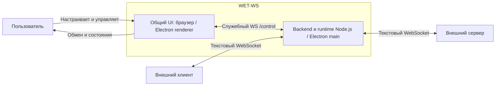
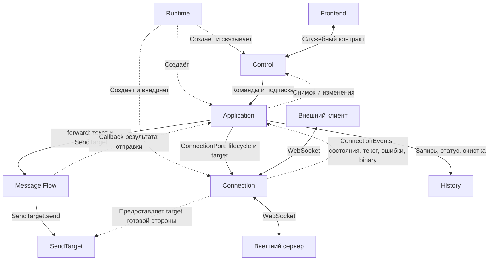
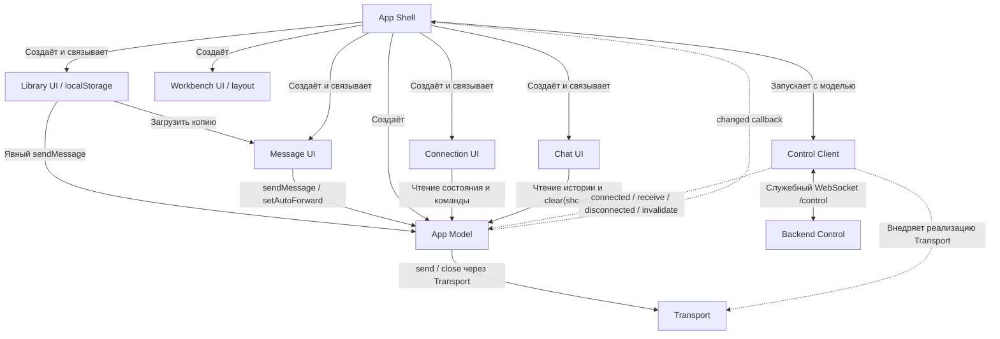
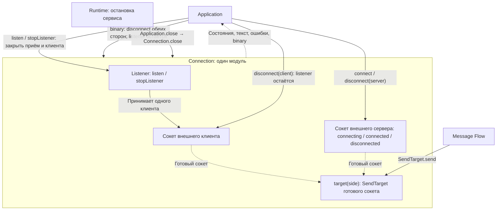
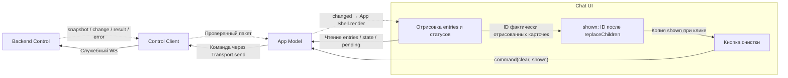

# Architecture

Единственное каноническое описание текущей реализованной архитектуры WET-WS. Архитектура сверена с реализацией; Iteration 2 принята автором 2026-10-17. Реализованная и проверенная delta Iteration 3 принята автором 2026-10-18 после живого демо; canonical UI обновлён по принятой delta. Результаты Iteration 3 — в [Context Pack 03](../iterations/iteration-03/context-pack.md). Результаты и ограничения — в [Context Pack 02](../iterations/iteration-02/context-pack.md#13-conformance--canonical-updates--done).

## System purpose and boundaries

Delta Iteration 04 (2026-10-24): ниже отражены реализованные и проверенные изменения исходников по согласованному чат-прототипу. Согласование прототипа и технические проверки не заменяют приёмку работающего приложения: она пока ожидается; canonical UI-свидетельства прежней принятой версии не заменены. Источник ревизии, gates и verification — [Context Pack 04](../iterations/iteration-04/context-pack.md).

WET-WS принимает внешнего WebSocket-клиента, отдельно подключается к внешнему серверу, пересылает новые текстовые сообщения при готовом получателе и показывает обмен. В систему входят общий UI, backend и runtime Node.js/Electron; внешние клиент и сервер находятся за её границей. Backend базы данных и постоянного хранилища не имеет; локальные заготовки принадлежат browser localStorage.

## Main components and physical structure

**Правило:** физическая структура `app/` должна максимально разумно отражать canonical / accepted logical architecture. Архитектурный модуль имеет понятное физическое место; границы ответственности не скрываются в произвольных файлах. Корень исходников остаётся `app/src/`, без второго параллельного дерева. Папки создаются только для существующего кода.

| Модуль | Каталог относительно app/src | Ответственность |
|---|---|---|
| Application | backend/application | Авторитетное состояние экземпляра/сеанса, команды и координация |
| Connection | backend/connection | Listener, два внешних соединения, их жизненный цикл и транспортные порты |
| Message Flow | backend/message-flow | Отправка через SendTarget и результат; без истории |
| History | backend/history | Записи, статусы, бюджет памяти и очистка; без очереди отправки |
| Control | backend/control | Служебный WS: команды, снимок, изменения и ответы |
| App Shell | frontend/app-shell | HTML/CSS, связывание UI-модулей и компоновка |
| App Model | frontend/app-model | Синхронизированное представление backend, ревизии и ожидающие команды; без DOM/WS-реализации |
| Connection UI | frontend/connection-ui | Поля, состояния сторон и действия подключения |
| Message UI | frontend/message-ui | Локальный редактор/адресат, отображение общего autoForward, намерения отправки и переключения |
| Chat UI | frontend/chat-ui | Отрисовка истории, показанные ID, раскрытие и намерение очистки |
| Library UI | frontend/library-ui | Локальные именованные заготовки, localStorage/20, ошибки хранения, загрузка копии и явная отправка |
| Workbench UI | frontend/workbench-ui | Ширины, сворачивание/восстановление редактора, переключение областей узкого окна |
| Control Client | frontend/control-client | Браузерный служебный WS и восстановление связи |
| Runtime | runtime | Composition root, HTTP-ресурсы, связывание реализаций и запуск Node.js/Electron |
| Shared | shared | Общие метаданные запросов и небольшие чистые guards в contracts.ts |

Runtime создаёт Connection и передаёт его Application через ConnectionPort; Control получает Application. Application использует History и Message Flow, не frontend. Message Flow зависит от SendTarget, не от библиотеки ws. Backend владеет состоянием; интерфейсы хранят его синхронизированное представление. История и незавершённая отправка независимы.

App Shell связывает App Model, Connection UI, Chat UI, Message UI и Control Client. Message UI сохраняет редактор и адресата локально в DOM без перезаписи при обновлениях истории; reload сбрасывает черновик. Application владеет общим autoForward (по умолчанию true), Message Flow — служебными командами send/set-auto-forward и транспортной отправкой; History не становится очередью. UI-модули обращаются к модели, не к backend-реализациям; App Model не импортирует DOM/WS, события транспорта получает через внедрённый интерфейс.

App Shell также связывает Library UI и Workbench UI; `frontend/ui.ts` содержит общие DOM/экранирование/декоративную подсветку. Библиотека слева, редактор в центре, чат справа. Layout хранит ширины и состояние сворачивания в памяти; narrow переключает области. Message UI владеет исходным текстом отдельно от textarea: браузер показывает LF, но отправка/сохранение сохраняют исходные CR/CRLF в нетронутых участках. Загрузка — копия, dirty replacement подтверждается; новые события, очистка и вытеснение источника не меняют черновик. Chat UI обновляет карточки по ID и не пересоздаёт редактор; раскрытие/pretty JSON не меняет payload. Повтор карточки захватывает исходного адресата, библиотека и редактор используют общий видимый локальный target.

Library UI хранит `wet-ws.templates.v1`: `{version:1,items:[{id,name,text}]}`. Максимум 20, имена непустые по trim, одинаковые имена допустимы. При quota/запрете/повреждении нет успеха и молчаливого сброса. Save/load независимы от backend; storage events обновляют набор между вкладками, запись перечитывает актуальный набор, но конкурентный read-modify-write остаётся last-write-wins, без merge-гарантии. Привязка к профилю/origin и исключение Electron описаны в [TB-002](../technical-backlog.md#tb-002--сохранность-localstorage-при-перезапуске-electron). Нового backend API/IPC для заготовок нет.

Client Acceptor, Server Connector и Pair Transport остаются операциями небольшого Connection, без отдельных классов/каталогов. History View, Rendered Tracker и Clear Action реализованы внутри Chat UI. Фиктивные адаптеры ws не создаются.

Тесты находятся в `app/tests/runtime` и `app/tests/integration`. Интеграционные сценарии охватывают несколько модулей и не дробятся ради повторения дерева.

## Runtime / deployment model

Общий `runtime/service.ts` вызывается из `runtime/server.ts` и `runtime/desktop.ts`; один UI используется в браузере и Electron. Electron не запускает дочерний сервер. Поставки используют общие исходники и lockfile.

Node.js по умолчанию слушает UI на 8080 с привязкой 0.0.0.0; порт приёма клиента задаётся отдельно, по умолчанию 8081. В контейнере оба порта публикуются явно. Electron запускает собственный сервис со свободным HTTP-портом и открывает локальный сетевой адрес. Каждый backend владеет своим состоянием; несколько интерфейсов одного экземпляра разделяют его. Reload UI не завершает внешний обмен; закрытие Electron завершает его сервис. Обмен между физическими LAN-компьютерами не запускался (NOT RUN). Автор исключил его из обязательных проверок текущей и будущих итераций; обязательный повтор не назначен.

## Architecture views

Сплошные стрелки — вызовы/использование либо подписанный обмен; пунктирные — события, данные или связывание по подписи, без обратных импортов реализаций.

### system-context — System Context

### backend-modules — Backend Modules

History хранит наблюдения, не очередь. Message Flow вызывает отправку через предоставленный `SendTarget`; поздний результат обновляет запись только пока она существует.

### frontend-modules — Frontend Modules

### backend-connection — Backend Connection

Порядок запуска сторон свободный. Обычное закрытие/ошибка одной стороны не закрывает другую; `stopListener` закрывает клиента и listener, сохраняя сервер. `Connection.close` завершает обе стороны и listener. При отсутствии готового получателя новое сообщение сохраняется без автоматической досылки. Client Acceptor, Server Connector и Pair Transport — операции этого модуля, без отдельных WS adapters.

### frontend-chat — Frontend Chat

«Показанные» означает отрисованные карточки, включая находящиеся вне видимой области прокрутки. Очистка ждёт backend-изменения; новые записи вне переданного набора сохраняются. Раскрытие текста и учёт shown локальны Chat UI. Источник истории — backend; App Model хранит синхронизированное представление.

## Main data / control flow

Выключение общего autoForward прекращает только последующие автоматические попытки обоих направлений; приём и наблюдение продолжаются. Включение не досылает историю и не отменяет ранее начатые отправки. Ручная команда выбирает готового адресата независимо от autoForward и второй стороны; Application фиксирует запись side=user с target и вызывает Message Flow с захваченным SendTarget. Поздний callback меняет только исходную существующую запись.

Внешний текст не оборачивается служебным JSON. Подключения независимы; принятый текст без получателя остаётся в истории и не досылается. Общее настроенное имя подпротокола должно совпасть на обеих сторонах. Обычное отключение стороны сохраняет другую и listener; binary закрывает оба соединения с причиной, listener остаётся доступен.

Сервис согласованно подписывает UI и передаёт снимок истории первым пакетом. Изменения имеют ревизию и виды added/updated/removed. При разрыве UI восстанавливает только служебную связь и получает свежий снимок; команды с неизвестным исходом не повторяются. Очистка передаёт ID уже отрисованных записей, не отменяет отправку и не возвращает запись поздним статусом.

## Architectural constraints

- История ограничена 1000 записями / 4 МиБ; вытеснение показано пользователю. Бюджет истории не ограничивает транспортное сообщение.
- Перегрузка, backpressure, queue/message-size policies отложены в [TB-001](../technical-backlog.md#tb-001--асимметричная-скорость-соединений).
- HTTP выдаёт ресурсы по явному списку; служебный WS проверяет Host и соответствующий Origin. Это не аутентификация. Произвольное переназначение опубликованного HTTP-порта и все варианты LAN-доступа не подтверждены.
- Electron renderer не имеет Node.js API; включены context isolation и sandbox, внешние переходы и новые окна запрещены. Ресурсы локальные, без CDN.
- TLS, аутентификация и публичное размещение не входят в проверенный объём.

## Current control contract

Служебный /control отделён от произвольного текста внешней пары. Root app/src/protocol.ts объединяет ControlClientMessage (команды Connection, очистка History и send/set-auto-forward Message Flow) и ControlServerMessage (обновления Application, ответы Control); это только типовые импорты/объединения. Определения и чистые guards находятся рядом с владельцами в backend/application/application.protocol.ts, connection/connection.protocol.ts, history/history.protocol.ts, message-flow/message-flow.protocol.ts и control/control.protocol.ts. shared/contracts.ts содержит только RequestMetadata и общие проверки, не второй полный API.

Control разбирает JSON как unknown и проверяет команды через control.validation.ts до Application.command. Корректный ID распознанного запроса позволяет вернуть result/ok:false; иначе возвращается error без непроверенного ID. Binary закрывает только служебную связь. Application сохраняет проверки актуальности экземпляра и допустимости действия по состоянию. Отправки используют общий тип; inline-дубликатов result/error нет. Отдельный backend Chat не создан: контрактом очистки владеет History.

Frontend Control Client проверяет snapshot/change/result/error до типизированного приёма AppModel. Неверный пакет немедленно делает представление неактуальным и закрывает служебное соединение; после закрытия повторное подключение откладывается на 1000 мс. Pending-команды имеют неизвестный исход и не повторяются. AppModel проверяет ревизии; новый снимок восстанавливает представление. Runtime выдаёт браузеру только явно перечисленные чистые protocol-модули и shared guards, не backend-реализации. Локальные protocol units не зависят от root, handlers/services и платформенных API.

Решения и результаты проверки этой дельты находятся в [Context Pack 02](../iterations/iteration-02/context-pack.md#организация-служебных-контрактов--review-use-with-changes-2026-10-16). Дельта входит в принятую автором Iteration 2.

Application snapshot/change содержит autoForward:boolean. `send {target:client|server,text:string}` и `set-auto-forward {enabled:boolean}` используют общие id/instance; некорректная форма отклоняется Control, неготовый адресат/старый instance — Application. `result ok` означает принятие/начало попытки; результат SendTarget отражён в истории, не доказывает обработку получателем. Для `side:user` History требует target; внешние записи сохраняют client/server и literal text. Смешанные версии UI/backend не поддерживаются. Источник delta и проверок — [Context Pack 03](../iterations/iteration-03/context-pack.md).

History.Entry допускает `payloadUnavailable:true`: History устанавливает флаг, когда бюджет требует заменить исходник заглушкой. Единственный owner/guard — `backend/history/history.protocol.ts`; App Model получает его через общий snapshot/change. Chat UI показывает причину и отключает открытие/повтор; совпадающий literal-текст без флага остаётся доступен. Runtime allowlist расширен только нужными frontend-модулями. Send, set-auto-forward и semantics reconnect не менялись; смешанные версии UI/backend не поддерживаются.

## Related documentation

[README приложения](../../../app/README.md) — сборка и запуск. [Context Pack 02](../iterations/iteration-02/context-pack.md) — решения, исходные proposal diagrams Astra и доказательства. Исходные пять схем Astra сохранены там без изменений как предложение; согласованные с принятой реализацией представления приведены выше. Отдельная архитектура или документ структуры каталогов не создаётся.
