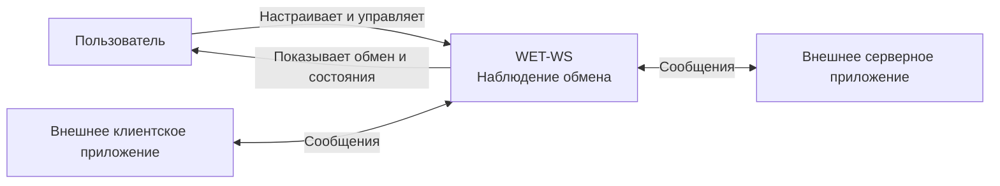
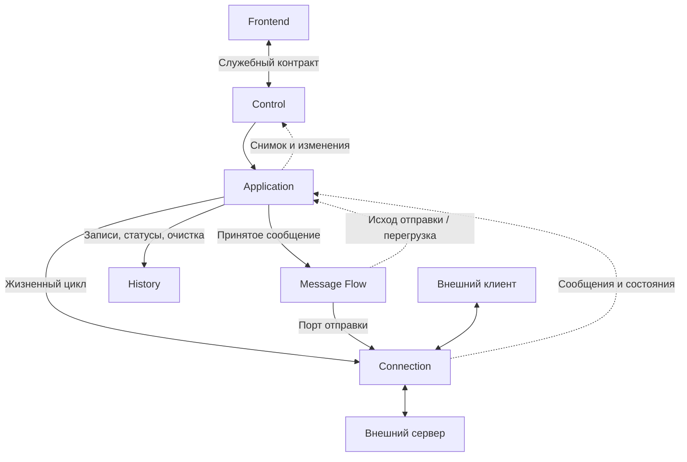
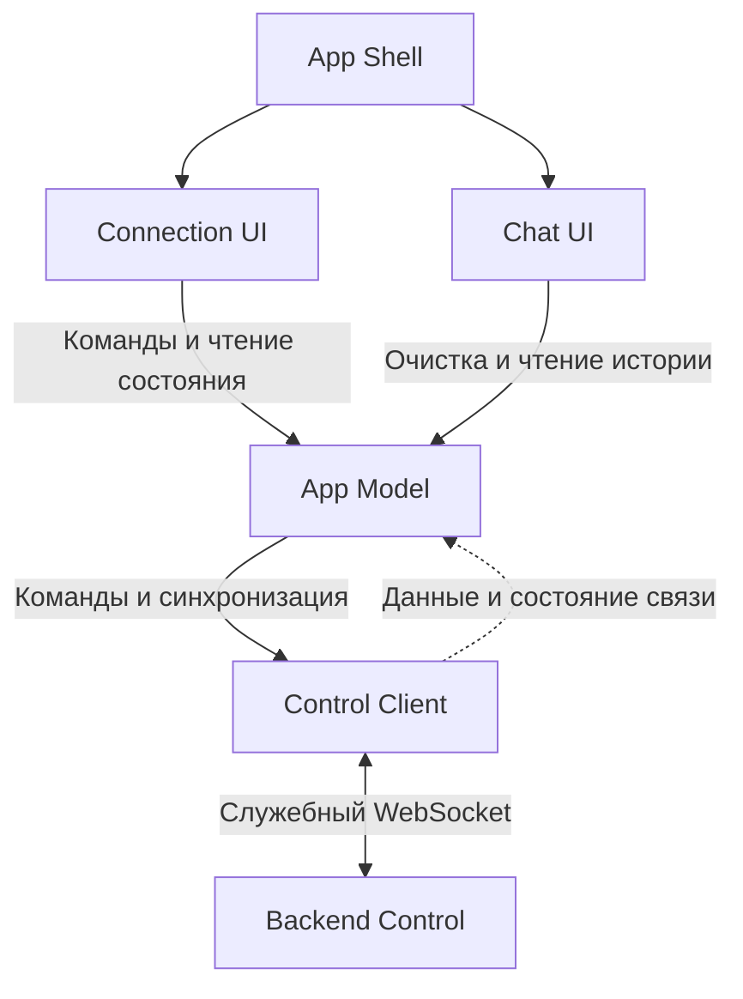
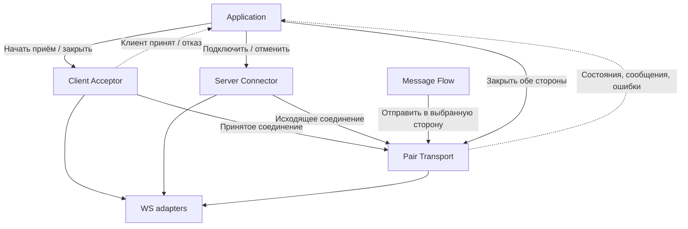
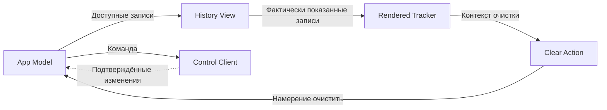

# Iteration Context Pack — 02: наблюдение обмена

## 0. Metadata

**Status: DONE. Iteration result: DONE / ACCEPTED by author 2026-10-17. Implementation: IMPLEMENTED / VERIFIED within accepted scope.** Обновлено 2026-10-11: автор разрешил реализацию после финального pre-implementation check. **Implementation Ready: PASS**; Q1–Q5 достаточны для реализации, TB-001 остаётся ACCEPTED_DEFERRED с backlog ID/review trigger. Автор принял всю итерацию 2026-10-17; Conformance/Done — PASS, итог в §13.

**Дополнение 2026-10-16:** дельта организации служебных контрактов принята и реализована; её Implementation Ready: PASS, проверки исходников/браузера/Windows и независимый review завершены, Linux NOT RUN из-за среды (раздел в §7). Основной статус реализации Iteration 2 и исторический Ready PASS выше сохраняются.

Это основной рабочий документ итерации: здесь изменяются поведение, решения, gates и план проверки. Он заменяет прежние `требования.md`. Принятие миграции не означает согласования открытых предложений.

## 1. Goal and scope

**Уточнение автора 2026-10-11:** приём клиента и подключение к серверу управляются независимо, в любом порядке. Сообщения без готового получателя видны в истории и автоматически позднее не досылаются (P02-02). Настройки активной стороны блокируются; отключение/разрыв одной стороны сохраняет другую (P02-04). UI автоматически восстанавливает служебную связь, несколько интерфейсов работают с одним экземпляром сервиса, LAN-доступ включён по умолчанию (§§7–8). Эти решения заменяют прежний автоматический порядок. Упоминание секунды в разговоре не задаёт таймер.

Дать пользователю наблюдение обычного обмена одного клиента и одного сервера через посредник: независимое подключение сторон → автоматическая пересылка новых сообщений при готовом получателе → чат → очистка/независимое отключение. Экземпляр сервиса хранит общее состояние всех интерфейсов; пара — одно клиентское и одно серверное соединение. Смена соединения не создаёт отдельный сервис или историю. История содержит сообщения и события текущего запуска. Сообщение — целое WebSocket-сообщение, не отдельный фрагмент кадра.

Поставки: Linux-контейнер с браузерным доступом по LAN и готовая Windows-программа из одного снимка. Сроки не назначены. Вне объёма: ручная/пошаговая пересылка, собственная отправка, самостоятельная проверка одной стороны, редактирование/сохранение сообщений, поиск/фильтры/экспорт, форматирование JSON, много клиентов, специальные условия подключения кроме согласованного ниже согласования подпротокола, публичное/корпоративное размещение и другие ОС. Полный офлайн не проверяется; спрос и оплата неизвестны, интервью и внешних пользовательских тестов пока нет.

## 2. Selected User Stories

Источник — текущие [roadmap](../../../product/roadmap.md#итерация-2--наблюдение-обмена) и [backlog](../../../product/user-stories.md#наблюдение-обмена); формулировки историй не копируются.

| Story | Покрытие и критерий |
|---|---|
| US-003 — завершение подключений | I02-05, К02-02/03 |
| US-004 — автоматическая пересылка | I02-02, К02-01 |
| US-005 — работа посредником | I02-01/02, К02-01 |
| US-006 — просмотр обмена | I02-03, К02-01/02 |
| US-007 — очистка истории | I02-04, К02-02 |

Истории включены целиком по текущей карте. Прежние ссылки на частичное покрытие историй 4/5 не задают текущий scope. US-008–US-010 отнесены к будущей итерации; US-022–US-024 не объявляются завершёнными проверкой двух локальных поставок.

## 3. Relevant Current State / Sources of Truth

Автор принял трансивер Iteration 2 2026-10-17; прежний baseline — эхо-версия 01. Текущая принятая архитектура — только [canonical overview](../../architecture/overview.md), при расхождении с историческими файлами действует он. Миграция его не меняет.

- [Context Pack 01](../iteration-01/context-pack.md) — исходная техническая основа.
- Архитектурная и протокольная дельта — §§7/9 этого пакета; сохраняет статус предложения и вопросы Q1/Q2, не описывает работающую систему.
- [default.svg](../../ui/mockups/main/default.svg), [default.png](../../ui/mockups/main/default.png) — принятая и реализованная design delta основного экрана; текущий набор — [canonical main](../../ui/mockups/main/default.svg). Существенные UX-переходы и условные предложения — §8.
- Основания: бизнес-запрос автора и согласованный сценарий наблюдения обмена; принятые решения и даты приведены в §5 этого пакета. Ближайшая работа и блокирующие вопросы — §§10–11 этого пакета; навигация — [README](../../../../README.md).

## 4. Required behavior — принято 2026-10-05, уточнено автором 2026-10-11

Идентификаторы I02/P02/К02 сохранены для трассировки; их изменение требует согласования автора.

| ID | Наблюдаемое поведение | Проверка |
|---|---|---|
| I02-01 | Один независимый клиент направлен через трансивер к одному серверу; готовность каждой стороны видна, без одной из них пара не готова. | Клиент знает только адрес трансивера; сервер видит отдельное подключение трансивера; отключение каждой стороны видно в UI. |
| I02-02 | Каждое допустимое текстовое сообщение, принятое при готовом получателе, автоматически пересылается без изменения содержимого и границ сообщения, с порядком каждой исходной стороны; повторной отправки трансивером нет. | Сравнить последовательности обоих независимых получателей: без пропусков, объединения и добавленных дублей при готовых исправных соединениях. Сообщения без получателя видны как не пересланные и после его подключения не досылаются. |
| I02-03 | Чат показывает содержимое, направление и порядок приёма трансивером. Общий порядок исходных отправок независимых сторон не обещается; одинаковые сообщения — разные записи. | Сверить чередующиеся и встречные сообщения с наблюдением приёма. |
| I02-04 | Очистка показанной истории не закрывает пару и не останавливает пересылку; следующие сообщения отображаются. | Между двумя уникальными сообщениями очистить: получатель получает оба, в истории остаётся второе. Дополнительные гонки — P02-06. |
| I02-05 | Пользователь независимо завершает ожидание/подключение выбранной стороны; другая сторона сохраняется. Отключение клиентского соединения не закрывает приём новых клиентов; завершение всего приложения закрывает его сервис. Причина видна. | Отключить каждую сторону, подтвердить сохранность другой и приёма клиентов; проверить отдельную остановку listener и завершение приложения. |
| I02-06 | I02-01–05 одинаковы в двух готовых поставках из общего снимка. | К02-01–03 отдельно на Linux-контейнере и распакованной Windows-программе; создание, запуск и обмен — разные результаты. |

## 5. Hidden Requirements and accepted constraints

P02-01–08 предложены аналитиком и приняты автором 2026-10-05. Уточнение границы очистки отдельно подтверждено 2026-10-07. Это принятые ожидания, не результаты испытаний.

- **P02-01 — старт и настройки:** URL сервера `ws://…` и локальная точка приёма клиента задаются пользователем. Путь/query сохраняются; после старта показывается адрес для клиента. Неверный URL, `wss://`, учётные данные в URL или занятый адрес дают понятную ошибку без ложной готовности, ввод сохраняется. Настройки подключённой стороны неизменны, отключённой редактируются; общий подпротокол меняется только при отключённых обеих сторонах (§8); хранение между запусками не требуется. Проверка: валидный путь/query, каждый отказ, исправление и новый старт.
- **P02-02 — независимые подключения и ранние сообщения (уточнено автором 2026-10-11):** пользователь независимо запускает приём клиента и подключение к серверу в любом порядке; автоматическое подключение сервера после первого клиента отменено. **Последующее решение автора:** если получатель ещё не готов, допустимое сообщение сохраняется в истории как не пересланное, без постановки на отложенную досылку. Подключение второй стороны не отправляет накопленные записи автоматически. Правило симметрично для клиента и сервера; порядок подключения выбирает пользователь. После готовности обеих сторон новые допустимые сообщения автоматически пересылаются по порядку исходной стороны один раз. История не является очередью отправки. UI различает ожидание, подключение и готовность. Политика очередей отложена: TB-001, ACCEPTED_DEFERRED. Недоступный/зависающий сервер не оставляет бесконечного подключения. Проверка: оба порядка подключения, сообщения каждой стороны до готовности другой, недоступный сервер и незавершённое рукопожатие. Точные механизмы и параметры ожидания остаются Q2/Q4.
- **P02-03 — дополнительные подключения:** второй клиент получает отказ, не заменяет первого и не создаёт второго серверного соединения; причина доступна как состояние/событие, первая пара продолжает работу. Политика подпротоколов уточнена автором 2026-10-11 (Q1): одно общее необязательное поле подпротокола для обеих сторон, согласованное с независимым управлением подключениями. Заданное имя предлагается серверу и выбирается на клиентской стороне только из предложений клиента; обе стороны готовой пары должны реально согласовать это же имя. Без настроенного подпротокола соединения устанавливаются без выбора подпротокола; это не гарантия успешного подключения. Несовпадение/отказ не маскировать фиктивным подтверждением; не выполнять автоматическую подмену или fallback, не преобразовывать прикладные протоколы. Это заменяет прежний отказ при обязательном подпротоколе и обсуждавшийся автоматический перенос списка клиента с ожиданием выбора сервера. Поддержка бинарных сообщений и интерпретация прикладных правил не добавляются. Источник: голосовое обсуждение 2026-10-11, автор подтвердил общее значение для прямой передачи между клиентом и сервером. Механизмы отказа и состояния отдельно подключённых сторон уточняются в Q2/Q3, проверки — в Q4.

- **P02-04 — завершение и восстановление (правило разрыва работающей пары повторно подтверждено автором 2026-10-11):** Прежнее правило общего завершения пары заменено уточнениями ниже для отключения сторон; недопустимые данные и остальные ошибки требуют сверки. Для ручной смены/неожиданного обрыва сервера и отключения клиента это заменено последующими решениями ниже; для переполнения очереди действует TB-001, ACCEPTED_DEFERRED, вместо прежней политики. Остальные случаи требуют сверки. Настройки и история сохраняются; очередь не воспроизводится. Новый сеанс — только вручную, без автопереподключения пары/повторной пересылки; старые сообщения и события не меняют новую пару. Проверка каждой причины, ручного стопа и нового старта.
**Уточнение автора 2026-10-11 — ручная смена сервера:** пользователь может отключить текущее серверное соединение и подключить другой сервер, сохраняя клиентское соединение и точку приёма. Трансивер не закрывает клиента автоматически из-за этого ручного отключения сервера; клиент может самостоятельно завершить связь по своим правилам/тайм-аутам, но обязательный тайм-аут клиента не предполагается. Это исключение заменяет прежнее завершение всей пары для указанного ручного действия; правило неожиданного обрыва сервера позднее уточнено ниже. Несколько одновременных внешних клиентов этим обсуждением не согласованы. Судьба ожидающих сообщений при смене целевого сервера, граница сеанса/истории и другие случаи ручного отключения остаются Q2/Q3; не принимать их по предположению.

**Последующее решение автора 2026-10-11 — сообщения, накопленные без сервера:** автоматически досылать накопленные сообщения после подключения нового сервера нельзя. Принятые сообщения остаются видны в истории с честным указанием отсутствия пересылки; очистку истории выполняет пользователь. Возможность ручной пересылки/досылки относится к будущим итерациям, не добавляется в Iteration 2. Автор затем подтвердил тот же простой вариант для первого подключения и для обеих сторон: порядок выбирает пользователь, сообщения без готового получателя остаются только в истории и позднее автоматически не досылаются. Это заменяет прежнее согласование ранней очереди P02-02. Выбор порядка не обещает сохранности пересылки всех ранних сообщений обеих сторон; отображение в ограниченной истории и фактическая пересылка различаются.

**Последующее решение автора 2026-10-11 — обрыв серверного соединения:** при неожиданном разрыве соединения с сервером клиентское соединение сохраняется; сообщения клиента без готового сервера показываются как не пересланные и автоматически впоследствии не досылаются. Сервер подключается заново только по действию пользователя. Это заменяет прежнее правило P02-04 завершать всю пару при разрыве сервера; правило не предполагает остановки внешнего сервера. Поведение при отключении клиента принято ниже; вопрос переполнения очереди отложен как TB-001; остальные ошибки требуют отдельной сверки.

**Принято автором 2026-10-11 — отключение клиента:** отключение клиентского соединения не закрывает соединение с сервером и не останавливает точку приёма новых клиентов. До подключения следующего клиента сообщения сервера показываются как не пересланные, без автоматической последующей досылки. Это заменяет прежнее правило P02-04 завершать всю пару при разрыве клиента; один одновременно подключённый внешний клиент остаётся границей Iteration 2.

- **P02-05 — смысл записи:** запись доказывает приём трансивером, не доставку получателю. Видно ожидание, передачу на отправку, отсутствие пересылки или неизвестный исход. Успешный send не означает «доставлено». Проверка: отсутствие готового получателя, разрыв во время отправки и независимый получатель.
**Уточнение автора — ошибка сообщения:** отображать соответствующий статус сообщения и краткую причину ошибки. Это не подтверждает доставку и само по себе не требует закрытия исправного соединения; точная реакция на отдельные ошибки отправки требует сверки с состоянием транспорта.

- **P02-06 — история и UI:** очистка удаляет только уже показанные сообщения/события, сохраняет ещё не показанные и очередь; поздний статус не возвращает удалённое. Разрыв и новый ручной сеанс сохраняют историю с разделением сеансов. Reload/потеря UI не прерывают пару; восстановление возвращает актуальное состояние и доступную ограниченную историю того же экземпляра без дублей/повторов. Пока связи нет, состояние явно неизвестно. Новый процесс начинает пустую историю; постоянное хранение не требуется. Проверка: очистка ожидающего сообщения и при отставшем UI, reload/разрыв UI, ручной новый сеанс и новый процесс.
- **P02-07 — текст:** пустая строка, пробелы, Unicode, переносы, HTML/JSON-подобный текст пересылаются буквально, показываются безопасно как текст; пустое сообщение различимо с пустой историей. Binary не преобразуется/не пересылается и завершает пару с причиной. Проверка обоих направлений независимыми получателями.
- **P02-08 — история и отложенная перегрузка:** бюджет истории остаётся 4 МиБ / 1000 записей; старые записи вытесняются с уведомлением, пересылка продолжается. Это бюджет сохранённого содержимого, не доказанный предел полной памяти процесса. Вопрос размера сообщений, очередей и flow control — [TB-001](../../technical-backlog.md#tb-001--асимметричная-скорость-соединений), `ACCEPTED_DEFERRED`, не blocker Iteration 2; прежние решения о лимитах и реакции на переполнение заменены этим статусом.

| Область | Принятое значение и реакция | Основание / проверка |
|---|---|---|
| Подключение сервера | 5 с от начала попытки; клиента ждём без тайм-аута с ручной отменой; тайм-аута ответа на сообщение нет | Преемственность 01; управляемые часы до/на границе и реальный незавершённый handshake, поздний open |
| Одно сообщение / очередь пересылки | [TB-001](../../technical-backlog.md#tb-001--асимметричная-скорость-соединений): ACCEPTED_DEFERRED, не blocker Iteration 2 | Специальные политики и граничные проверки возвращаются только по review trigger |
| История | ≤1000 записей (сообщений и событий) и ≤4 МиБ UTF-8; старые записи вытесняются до соблюдения обоих пределов, с уведомлением; пересылка продолжается | Ограничение локальной истории; независимо достичь/превысить каждый предел, проверить неизменную доставку получателям |

Существенные скрытые риски сведены в пять групп: транспортное доказательство (К02-01), состояние без получателя (P02-02); перегрузка отложена как TB-001, поздние события старого сеанса (P02-04), очистка и восстановление UI (P02-06), ложное подтверждение доставки (P02-05). Все имеют ожидаемое поведение и проверки; неизвестные механизмы остаются открытыми, а не становятся новыми требованиями.

## 6. Gate Results

Подготовительные PASS фиксируют достаточность решений до реализации; упоминания NOT RUN в их основаниях относятся к тому этапу. Фактические проверки и дополнение по финальным поставкам от 2026-10-12 — в §13. `Impact` отдельно от результата gate.

| Gate | Status | Impact / основание |
|---|---|---|
| Iteration Scope | PASS | Принятый компактный план и решения автора достаточны для подготовки; технические детали определяются при реализации в его пределах. TB-001 отложен, не blocker. Проверки работающей системы ещё NOT RUN. |
| Hidden Requirements | PASS | Принятый компактный план и решения автора достаточны для подготовки; технические детали определяются при реализации в его пределах. TB-001 отложен, не blocker. Проверки работающей системы ещё NOT RUN. |
| Architecture Impact | PASS | Принятый компактный план и решения автора достаточны для подготовки; технические детали определяются при реализации в его пределах. TB-001 отложен, не blocker. Проверки работающей системы ещё NOT RUN. |
| Protocol & Data Contract | PASS | Принятый компактный план и решения автора достаточны для подготовки; технические детали определяются при реализации в его пределах. TB-001 отложен, не blocker. Проверки работающей системы ещё NOT RUN. |
| UX Impact | PASS | DELTA: итоговые main/default и main/default-stacked и описанное поведение приняты 2026-10-11. Статические превью не подтверждают реализацию, клавиатуру или доступность; эти проверки в §12. |
| Reliability & Concurrency | PASS | Принятый компактный план и решения автора достаточны для подготовки; технические детали определяются при реализации в его пределах. TB-001 отложен, не blocker. Проверки работающей системы ещё NOT RUN. |
| Implementation Ready | PASS | Подготовка достаточна, автор разрешил реализацию; код реализован. |
| Verification | PASS | Итоговые Windows ZIP и offline Docker bundle прошли реальные проверки обмена (§13, дополнения 2026-10-17); npm test 49 PASS. Физический межмашинный LAN NOT RUN / EXCLUDED BY AUTHOR, не условие приёмки. |
| Architecture & Contract Conformance | PASS | Финальный Independent Reviewer: PASS по архитектуре и evidence; пять canonical схем обновлены, принятая UI delta перенесена, старые артефакты удалены с разрешения автора. |
| Iteration Done | PASS | Результат принят автором 2026-10-17; применимые проверки и Conformance завершены, canonical обновлены. Межмашинный LAN исключён автором и не объявляется проверенным; TB-001 отложен. |

`ESCALATE` не назначался. Astra не требуется для самой миграции; сложный узкий вопрос можно эскалировать отдельно с возвратом решения в этот пакет.

## 7. Architecture and protocol impact

Сохраняемую основу показывает overview. **Предлагаемая дельта, не принято целиком:** заменить echo-экран и `/ws` посредником без второго пользовательского режима; добавить два внешних соединения и отдельный служебный `/control` с JSON, хранить состояние пары/очереди/истории в сервисе. UI получает снимок и последовательные ревизии, команды имеют ID и контекст экземпляра/сеанса/истории; вход проверяется на сервисе. Пропуск ревизии требует синхронизации; неизвестный исход команды не запускает автоматический повтор. Внешний текст не смешивается со служебными сообщениями.

Проект предлагает backend Application, Connection, Message Flow, History, Control и frontend App Shell, App Model, Connection UI, Chat UI, Control Client вместо текущего echo-пути; runtime связывает реализации. TypeScript + DOM и Node.js/ws предлагается сохранить в существующих точках запуска. React рассмотрен как альтернатива, не выбран; переход добавит новый путь сборки и повторную проверку обеих поставок. Отдельные C4-диаграммы и дерево новых файлов не являются обязательными артефактами: нужны только при самостоятельном вопросе. Рекомендация TypeScript + DOM — предложение для одного экрана и сохранения проверенной сборки, не измеренное преимущество.

Размещение в проекте: раздельные порты UI/клиента 8080/8081, прежняя предложенная публикация на loopback хоста заменена принятым ниже доступом по LAN, Windows HTTP-порт динамический. Адрес привязки отличается от адреса клиента, `0.0.0.0` не является адресом подключения; адрес сервера разрешается из среды сервиса, `127.0.0.1` контейнера не означает хост. Профиль публикации/маршрут стенда не проверены. Точные решения и профиль запуска определяются в реализации по принятому плану; необходимые предложения сохранены ниже, полного отдельного проекта архитектуры нет.

Контракт принятого внешнего поведения — §§4–5 этого пакета. Проект дополнительно предлагает не выполнять серверные редиректы и не копировать cookies/Origin/заголовки клиента серверу, обрабатывать ping/pong по участкам, завершать пару при неверном UTF-8. При согласовании подпротокола действует принятое 2026-10-11 P02-03; прежнее предложение отклонять любой подпротокол отменено. Обработка двух независимых подключений с общим настроенным подпротоколом требует технической сверки Q2; ранние сообщения по P02-02 не удерживаются для досылки. Эти механизмы и уточнения не становятся принятыми из-за миграции. Границы сообщений сохраняются, границы фреймов могут меняться.

**Принято автором 2026-10-11:** интерфейс получает состояние подключений и историю и отправляет команды через отдельное служебное WebSocket-соединение с сервисом. Обмен внешнего клиента и сервера отделён от этого канала; обновление страницы или потеря служебной связи не останавливает работающую пару. После сравнения с HTTP + SSE автор подтвердил WebSocket для текущей итерации: интерфейс должен оперативно получать состояние подключений, сообщения и изменения их статусов. Необходимость дополнительного HTTP API может быть рассмотрена при дальнейшем развитии продукта; это не обязательство текущей итерации и не утверждение, что HTTP + SSE технически непригоден. Также принято автором: после разрыва служебной связи интерфейс заново получает актуальное состояние; команды с потерянным ответом автоматически не повторяет. Автоматическое восстановление UI принято в §8; конкретный адрес, схема команд и параметры попыток остаются техническими деталями Q2.

**Принято автором 2026-10-11 — поток истории:** при инициализации UI первое служебное сообщение содержит массив всей текущей сохранённой истории; последующие сообщения содержат массивы изменений, обычно с одним элементом. В том же потоке явно различаются добавление записи, изменение её статуса и удаление при очистке, чтобы обновление не создавало дубль. Сервис согласованно ставит начальную историю первой в очередь и включает последующие изменения без зазора между снимком и подпиской. Формат относится только к служебному каналу, не меняет сообщения внешнего клиента/сервера. Нумерация ревизий остаётся предложенным механизмом проверки, не отдельно принятым решением; точная схема полей, состояние подключений и механизм подтверждения показанного набора требуют Q2/Q3; пользовательская семантика очистки принята в §8.

**Принято автором 2026-10-11 — единый сеанс сервиса, несколько синхронизированных интерфейсов:** каждое новое подключение UI присоединяется к существующему состоянию того же экземпляра сервиса, не создаёт отдельного рабочего сеанса или внешней пары и не запускает/останавливает их. Все вкладки показывают одну пару, общую историю и статусы; просмотр и управление доступны в каждой. Действия изменяют общее состояние и отражаются во всех подключённых интерфейсах через служебные обновления: в частности, очистка выбранных записей удаляет их из общей истории и из остальных вкладок. Новая вкладка не перехватывает управление и не отключает команды предыдущей. Принцип одинаков для всех вкладок; он не обещает неограниченного числа подключений или проверенной нагрузочной ёмкости. Сервис проверяет команды по актуальному состоянию: одновременные повторные команды подключения не создают второе подключение. Точный ответ на повторную/устаревшую команду и согласование одновременных очисток остаются техническими уточнениями Q2/Q3.

**Принято автором 2026-10-11 — локальная сеть:** в Iteration 2 интерфейс сервиса и приём внешнего клиента доступны с других компьютеров локальной сети по умолчанию, без отдельного переключателя доступа в UI. Это относится к браузерной и настольной поставкам; локальное окно Electron остаётся интерфейсом того же сервиса. Реализация должна принимать сетевые подключения, а инструкция запуска — описать публикацию портов контейнера и доступность через firewall. Доступ не гарантируется одним фактом общей сети. Конкретные порты, сетевые адреса и проверки Host/Origin требуется согласовать с этим режимом, не оставлять loopback-only ограничение. Интернет-публикация и полноценная аутентификация этим решением не согласованы.

### Границы ответственности — Q2, частично принято

- **Принято автором 2026-10-11:** сервис владеет подключениями/сеансом, очередями и историей; UI отправляет команды и представляет состояние, не управляет сокетами внешней пары. Источник: ответ «Конечно, в сервисе» на вопрос о владельце состояния. Это не согласование всего Q2. **Дальнейшее предложение:** Application, Message Flow и History не зависят от Electron, DOM и конкретной WS-библиотеки; runtime связывает их с реализациями Connection и Control. Общий контракт не импортирует серверные реализации, Electron остаётся точкой запуска. Отдельные микросервисы и хранилище не предлагаются.
- Сеанс решает, когда завершать пару; транспорт сообщает ошибки; история не управляет соединениями. Старт/стоп сериализуются, повторный стоп безопасен, следующий старт соответствующей стороны ждёт освобождения её ресурсов. Первый клиент резервирует сеанс до окончания handshake; лишний не изменяет занятую пару.
- Listener данных создаётся по ручному старту. Публикация его порта готовится вне приложения; оно не управляет Docker. Успешная привязка внутри контейнера не доказывает доступность адреса с хоста. Windows должна поддерживать принятый LAN-доступ; прежнее ограничение отдельным loopback-listener отменено; конфликт с HTTP-портом UI или чужим процессом означает ошибку.
- Служебный вход сохраняет Host/Origin и явный список статических ресурсов; renderer изолирован. Внешний listener имеет отдельные проверки сеанса/адреса/формата и не требует Origin интерфейса WET-WS. Публичная защита и аутентификация из этих мер не следуют.
- Форму входных служебных команд проверяет сервис во время исполнения. Устаревшие стоп/очистка отклоняются с необходимостью синхронизации. Неверная, бинарная или слишком большая команда затрагивает только служебное соединение, не внешнюю пару. Новое управляющее соединение не запускает и не останавливает пару самим фактом подключения.

### Предложение модульных границ по анализу 2026-10-11 — Q2

Не реализовано и не принято целиком. Названия ниже — логические модули, не новое обязательное дерево файлов. Уже принятое владение состоянием сервисом сохраняется; разделение реализации остаётся предложением.

- **Backend:** Application координирует сеанс и действия через порты Connection, Message Flow и History; Connection реализует жизненный цикл внешних WS-подключений и сообщает события; Message Flow ведёт пересылку; специальная политика очереди отложена как TB-001; History хранит записи/события и их изменения; Control переводит команды UI в действия Application и передаёт согласованное представление состояния/истории. History не управляет подключениями или отправкой. Очередь Message Flow независима от истории: очистка/вытеснение записей не отменяет ожидающую передачу.
- **Runtime:** точки запуска связывают реализации и внедряют зависимости. Зависимости реализации направлены от Control к интерфейсу Application, от Application — к портам Connection, Message Flow и History. События Connection/Message Flow возвращаются через согласованные callbacks/порты; обратное событие не требует обратного импорта Application. Логика сеанса не импортирует runtime, Electron или DOM; общие типы контракта не импортируют реализации backend/frontend.
- **Frontend:** App Shell связывает App Model, Connection UI, Chat UI и Control Client. App Model хранит синхронизированное представление backend-сеанса и отдельное локальное UI-состояние; Connection UI и Chat UI показывают это представление и передают действия App Model. App Model использует интерфейс Control Client для команд и синхронизации; Control Client реализует служебный транспорт. UI-компоненты не управляют внешними сокетами; App Model не зависит от DOM. Направление зависимостей: App Shell → реализации; Connection UI / Chat UI → интерфейс App Model; App Model → интерфейс Control Client. Backend остаётся владельцем сеанса, frontend — его представления, не второй копии управления.

После принятия, реализации и проверки этой дельты обновить затронутые разделы canonical overview и добавить пять Mermaid-представлений: `system-context` (граница системы и внешние участники), `backend-modules` (направления зависимостей backend), `frontend-modules` (направления зависимостей frontend), `backend-connection` (согласованный жизненный цикл двух независимых подключений), `frontend-chat` (показ и обновление чата по согласованному контракту). До этого не публиковать их как current canonical. В схемах использовать те же названия и владельцев состояния, что в тексте; различать зависимости и события, не вводить новых решений и не дублировать перечни ответственности. Точные переходы зависят от Q2/Q3, доказательства — от Q4; эта запись не закрывает Q1–Q5 и не меняет Ready BLOCK.
### Исходные диаграммы Astra — архитектурное предложение Iteration 2

**PROPOSAL — not canonical until implementation and verification**

Исходные схемы сохранены без изменения Mermaid-блоков. Операция «Закрыть обе стороны» в исходном backend-connection не является правилом при отключении одной стороны: актуальные переходы задаются P02-04. При реализации схему нужно сверить с независимым закрытием соединений и отдельным полным завершением сервиса; исходная схема не отменяет позднейшие решения автора.

Источник: архитектурный ответ от 2026-10-11 в чате «Нормализовать архитектурную докуме». Ниже сохранены именно пять исходных Mermaid-блоков, без изменения их содержимого. Это предложение для посредника Iteration 2, не схема текущей эхо-версии; canonical overview сейчас не меняется.

Responsibilities и модули описаны выше. В схемах сплошные стрелки показывают вызовы/использование портов либо явно подписанный обмен, пунктирные — обратные события и данные; это не утверждение о взаимных импортах реализаций. Runtime связывает реализации, хотя отдельным узлом в исходных схемах не показан. Backend Control — тот же backend-модуль Control, Frontend — frontend в целом. Client Acceptor, Server Connector и Pair Transport — предложенные компоненты Connection; WS adapters скрывают библиотеку. History View, Rendered Tracker и Clear Action — предложенные части Chat UI для показа, учёта показанных записей и намерения очистки, не отдельная авторитетная история или очередь отправки.

Q1 сохраняет последнюю согласованную политику общего подпротокола и независимого управления сторонами; схемы не вводят отменённый автоматический порядок подключения. Q2 остаётся частично открытым для реализации границ/контракта, Q3 — для показанного префикса и UX очистки, Q4/Q5 — для проверок и реализации. Исходные стрелки не закрывают эти вопросы; Implementation Ready остаётся BLOCK.

#### system-context — System Context

#### backend-modules — Backend Modules

#### frontend-modules — Frontend Modules

#### backend-connection — Backend Connection / Components

#### frontend-chat — Frontend Chat / Components

После принятия, реализации и verification сверить эти proposal diagrams с фактической системой, скорректировать при необходимости и только затем перенести согласованные представления в canonical architecture. До этого исходные блоки остаются здесь; второй architecture.md или отдельный каталог diagrams итерации не создаётся.

Canonical update: **NO CHANGE при миграции**. Сначала принять дельту здесь, затем обновлять затронутую часть overview по фактической реализации; исторический проект не копировать в current. Новые ADR не создаются автоматически.

### Организация служебных контрактов — review «Use with changes», 2026-10-16

**Статус: ACCEPTED / IMPLEMENTED / VERIFIED в пределах исходников, браузера и Windows; Linux NOT RUN / ENVIRONMENT LIMITATION. Implementation Ready: PASS (2026-10-16).** Автор принял дельту и прямо разрешил её реализацию. Исторические gates остальной Iteration 2 не меняются; завершение этой задачи не означает Done итерации.

Предыдущий review оценивал предложение без повторного доступа к репозиторию. Повторная проверка исходников обнаружила неполный общий API (inline result/error в Control и AppModel), частичную проверку формы после JSON.parse и смешение проверок формы со состоянием. Эти пробелы устранены. Существующее дерево backend сохранено; modules/, backend Chat, DTO/registry/package и новые команды не добавлены.

| Единственный владелец | Определения относительно app/src |
|---|---|
| Connection | backend/connection/connection.protocol.ts: Settings, Side, Phase, ConnectionCommand (listen, stop-listener, connect, disconnect-client, disconnect-server) и чистые guards |
| History | backend/history/history.protocol.ts: Entry, EntryChange, ClearHistoryCommand (clear/shown), guards записей/показанных ID. Chat UI только отображает и инициирует действие. |
| Application | backend/application/application.protocol.ts: SessionState и SessionUpdate (snapshot/change), guards составного состояния; Settings/Entry не дублируются |
| Control | backend/control/control.protocol.ts: единственные ControlResult/ControlError и их guard; control.validation.ts собирает проверку входящих команд |
| Общие метаданные | shared/contracts.ts: RequestMetadata (id/instance) и маленькие общие проверки record/ID/counter; прежние Command/Update отсюда удалены |
| Root | protocol.ts: только import type и объединения ControlClientMessage / ControlServerMessage из локальных определений, без исполняемых импортов и экспорта backend-реализаций |

**Зависимости и границы.** Backend Control и frontend Control Client/AppModel используют полный контракт. Application.command принимает локальные ConnectionCommand | ClearHistoryCommand; History и Connection используют свои типы. Application.protocol импортирует protocol-определения и guards Connection/History, локальные protocol units не импортируют root, handlers/services, Node.js/ws/Electron/DOM. Только типовые зависимости используют import type. Handler/service/DTO-файлы ради симметрии не создавались; проверенный payload поступает в существующий обработчик напрямую. Служебный контракт не оборачивает, не нормализует и не ограничивает произвольный внешний текст.

**Принято автором и реализовано.** JSON.parse возвращает unknown; до Application.command проверяются конверт, action и необходимые поля, включая реальное JSON-представление чисел/массивов. Валидный ID — непустая строка, без ограничения форматом UUID. Распознанный запрос с таким ID при неверной форме получает result/ok:false с проверенным ID; неразбираемый конверт или невалидный ID — error без отражения непроверенного ID. Корреляция отказа требует объекта с полем action, а не произвольного JSON с id. Binary служебного канала даёт error при доступном транспорте и закрытие 1003; WS-нарушения обрабатывает библиотека. Внешняя пара не меняется от неверного служебного ввода. Нового лимита размера нет: текущий maxPayload:0 и deferred TB-001 сохраняются; число для «чрезмерного» сообщения этой дельтой не придумывается.

Frontend Control Client проверяет полный snapshot/change/result/error до передачи типизированного пакета AppModel. Некорректный пакет немедленно делает представление неактуальным, очищает pending как неизвестный исход и закрывает только служебный канал. После закрытия используется действующий интервал 1000 мс; поздние пакеты отвергнутого соединения игнорируются, автоматического повтора команд нет. Снимок восстанавливает актуальное состояние, не доказывая исход старой команды. AppModel сохраняет проверку непрерывности ревизий и владельца экземпляра; Application сохраняет актуальность instance, busy, правила активных сторон/общего подпротокола и допустимость параметров операций. History, очистка показанных ID, отсутствие возврата удалённых записей поздним статусом, внешние отключения и отсутствие досылки сохранены.

**Затронутые файлы.** Добавлены четыре локальных protocol units, root и control.validation.ts; обновлены импорты Application/Connection/ports/History/Connection UI, dispatch Control и приём/отправка AppModel/Control Client. runtime/service.ts публикует по явному списку только необходимые браузеру чистые protocol/guard-модули и shared/contracts.js; backend-реализации и control.validation.js не публикуются. Перенос самого service.ts в backend остаётся отдельной отложенной правкой из беседы, здесь не выполнялся.

**Gates этой дельты:** Scope PASS; Architecture Impact PASS / DELTA; Protocol & Data Contract PASS; UX SKIP / NO_CHANGE; Reliability & Concurrency PASS; Implementation Ready PASS. Verification: PASS для исходников, браузера и новой Windows-поставки; Linux build/run NOT RUN из-за среды, без заявления полной совместимости поставок. Architecture & Contract Conformance: PASS для этой реализованной дельты по коду и проверенным путям. Independent Reviewer: PASS в пределах read-only review ниже. ESCALATE → Astra не требуется. Отдельного handoff нет.

**Проверки:** npm test — 48 PASS, включая 29 исторических legacy-тестов (не доказательство нового UI). Новые tests/integration/control-protocol.test.mjs проверяют шесть команд и все серверные ветви после JSON-сериализации, неверный JSON/ID/payload/type, NaN→null, отдельные от формы отказы состояния, отсутствие dispatch/изменения состояния при неверном вводе. Реальный WS доказывает продолжение внешнего echo после закрытия служебного канала по binary (1003) и невалидному UTF-8 (1007), новый снимок, действующие команды и allowlist браузерных protocol-ресурсов без публикации реализаций. Отдельный реальный control transport со spy-handler подтверждает нулевое число вызовов обработчика для неверных форм и один вызов для корректной команды. Реальная frontend WS-связь с управляемым сервером доказывает немедленную инвалидизацию, неизвестный исход, восстановление снимка, интервалы не менее 900 мс в наблюдении и отсутствие повтора команды после неверного ответа. npm run check:iteration-02 в установленном Edge — PASS: буквальный echo, две вкладки, reload/восстановление, общая очистка, независимое отключение и узкий экран. Проверка другой физической LAN-машины не выполнялась.

**Поставки / среда проверки:** финальные 48 тестов выполнены на локальном Node.js 24.21.0. Windows собрана из снимка app/out/source-snapshots/a022ac979461c79d2a5c7f7e534cab42db4f9397687f55f6fb7d91fd95e87de4 (50 файлов): npm ci --offline --omit=dev --ignore-scripts, npm run build, @electron/packager с существующим forge.config и локальным Electron 44.5.1. SHA256 локального архива сверен с node_modules/electron/checksums.json; проверка целостности не отключалась. Первая упаковка до сборки snapshot остановилась из-за отсутствия dist; после установки зависимостей из кэша и сборки упаковка прошла. Новый executable app/out/build/retained/control-protocol-a022ac979461/wet-ws-ai-win32-x64/wet-ws-ai.exe прошёл npm run check:iteration-02 -- desktop: запуск, буквальный echo, общий сеанс с браузером, reload, общая очистка, независимое отключение, узкое окно. Исходники продукта побайтно совпадают со снимком; позднее добавлены только проверки spy-handler/UTF-8, выполненные на текущем дереве. Это проверка packaged executable, новый ZIP в этой задаче не создавался.

Linux: docker build --platform linux/amd64 -t wet-ws-ai:control-protocol . не начался из-за недоступного Docker Desktop Linux Engine (pipe отсутствует); попытки запуска установленного Desktop не восстановили Engine. Создание/запуск нового Linux-образа NOT RUN / ENVIRONMENT LIMITATION. Общая TypeScript-сборка и allowlist браузерных protocol-ресурсов проверены, но не заменяют сборку/запуск контейнера. Старые образы не считаются доказательством этой дельты. Обычный sandbox exec также недоступен (setup refresh); команды выполнены с разрешённым доступом вне неисправной песочницы.

**Independent Reviewer (2026-10-16): PASS в пределах прочитанной дельты, существенных дефектов не обнаружено.** Проверены локальные units/root, guards обоих направлений, send/dispatch, state-инварианты Application, инвалидирование и pending, задержка восстановления, игнорирование поздних пакетов, binary-изоляция и allowlist, оба интеграционных тестовых файла. Reviewer самостоятельно тесты не запускал и сравнение TEMP-снимка не выполнял; доказательства browser/Windows предоставлены основным агентом, Linux им не подтверждён. Замечаний для исправления нет. Полная Iteration 2 не объявлена Done; её приёмка, прежние ограничения и nonblocking Process Health Check после Done не подменяются завершением этой задачи. Commit не создавался.

## 8. UX impact

Принят основной экран 2026-10-09: настройки и состояния рядом с соответствующими полями слева, чат справа с регулируемой шириной; клиент слева, сервер справа, постоянные подписи сторон, без номеров и повторения сторон в карточках. Длинное сообщение раскрывается/сворачивается без изменения данных, статуса и фокуса; 8 строк — предложенный ориентир, не лимит сообщения. Разделитель и кнопки на SVG статичны, доступность и поведение предстоит проверить.

Существенные состояния: нет актуальных данных → команды заблокированы; старт → ожидание клиента → подключение сервера → готовая пара; стоп/ошибка → причина и ручной новый старт. Настройки активного сеанса только для чтения. Потеря UI показывает неизвестное состояние, не останавливает пару; команды разрешаются после восстановления актуального представления. Отправки/стоп/очистка не повторяются автоматически при неизвестном исходе.

История показывает буквальный текст, пустое сообщение отдельно от отсутствия записей, направления и честные статусы: «Ожидает пересылки», «Передано на отправку», «Не переслано», «Результат неизвестен». «Очистить показанное» не очищает очередь, не возвращает удалённое поздним статусом, не обещает пустую ленту после прихода новых сообщений. Принята очистка уже показанных записей; толкование показанного набора и запрет редактирования настроек при активном подключении уточнены автором ниже; оставшиеся механизмы требуют Q3.

### Существенные состояния и действия

| Событие | UI / доступность / восстановление |
|---|---|
| Первое открытие | «Получаем состояние трансивера…», стороны неизвестны; старт/стоп/очистка недоступны до актуального снимка. |
| Покой / старт | «Сеанс не начат», обе стороны не подключены, «Сообщений пока нет». Старт → «Открываем точку приёма…»; повтор команды и изменение настроек заблокированы до результата, ввод сохранён. |
| Listener открыт / клиент принят | «Ожидаем клиента» без обратного отсчёта, адрес для клиента показан; сервер подключается только по отдельному действию пользователя, состояния двух сторон независимы, исходящее подключение ограничено 5 с. Ранние сообщения только отображаются как не пересланные. |
| Пара готова | Автоматическая пересылка включена; стоп и очистка доступны, настройки подключённых сторон только для чтения и копирования. |
| Стоп ожидает / завершён | «Отключаем выбранную сторону…», её повтор/старт недоступны до результата; другая сторона не объявляется закрытой. После — выбранная сторона отключена, история сохранена, её настройки редактируемы, другая сторона сохраняется. |
| Ошибка старта / пары | Локальная ошибка у поля либо «Соединение закрыто: [причина]» у соответствующей стороны. Неверный адрес/занятый порт не дают рабочего адреса; Разрыв и binary имеют конкретную причину; окончательная реакция на недопустимые данные требует сверки. Специальная реакция на переполнение отложена по TB-001. История/ввод сохранены, данные автоматически не повторяются. |
| Дополнительный клиент | Событие отказа не обозначает первую пару неисправной и не создаёт второй пары. |
| UI потерян / восстановлен | Последние известные данные явно устарели, состояние пары неизвестно, команды запрещены. После связи — «Обновляем состояние…»; только применение актуального снимка разрешает допустимые действия. Новый процесс явно означает недоступность прежней истории. |

Подписи настроек постоянны: целевой URL сервера, адрес привязки, порт. URL сохраняет путь/query. Адрес клиента появляется после подтверждения listener и доступен копированию; `0.0.0.0` не выдаётся за адрес подключения. В контейнере пояснить доступность сервера из среды сервиса и зависимость внешнего доступа от публикации порта; в Windows — доступность с компьютера. Формирование внешнего адреса остаётся Q2/Q3, изображения содержат примеры, не значения по умолчанию.

Карточка содержит время, буквальный текст и статус; источник обозначен краем и постоянной подписью стороны, дополнительно цветом. Порядок приёма сохраняется расположением, одинаковый текст даёт разные записи. События и разделители сеансов отличают предыдущий обмен; очистка не лишает оставшиеся записи принадлежности сеансу. Статус обновляется на месте без копии и возврата удалённого. «Передано на отправку» означает передачу транспорту, а не доставку; «Не переслано» сопровождается причиной, «Результат неизвестен» — отсутствием подтверждённого исхода начатой отправки. По решению автора постоянное пояснение о приёме/доставке на экране не показывать; смысл статусов P02-05 сохраняется.

Пустой текст подписывается вне тела «Пустое сообщение · 0 байт», пробельный — «Только пробельные символы · N байт»; тело не меняется. Длинные строки переносятся визуально, полный текст доступен раскрытием и копированием без декоративных подписей. Кнопка «Развернуть» / «Свернуть» сообщает своё состояние и не переносит фокус. 8 строк и ширина до 95% — ориентиры макета, не принятые ограничения данных.

**Принято автором 2026-10-11 — узкое окно:** настройки располагаются сверху, чат снизу; набор функций сохраняется, отдельный мобильный интерфейс не создаётся. Это согласование направления компоновки, не принятие старых main/default-narrow или main/state-sheet и не подтверждение реализации. Старые варианты остаются исключены из активной delta и merge; будущая визуальная delta должна отражать согласованное направление.

**Принято автором 2026-10-11 — восстановление UI:** после временного разрыва служебной связи интерфейс автоматически переподключается к сервису и получает актуальное состояние подключений, истории и статусов, без ручной перезагрузки страницы. Пока связи нет, показывается потеря связи/неизвестное состояние; команды с потерянным ответом не повторяются. Это не автоматическое восстановление внешних соединений клиента/сервера. При смене сети, затронувшей только браузер, наблюдение восстанавливается автоматически; если разорвано внешнее соединение сервиса, оно восстанавливается вручную. Интервал и ограничение частоты попыток — детали реализации, фиксированное значение не согласовано.

### Явные UX-предложения и будущая проверка — Q3

- **Принято автором 2026-10-11:** «показанные» — записи, уже добавленные (отрисованные) в чат к моменту нажатия очистки, включая находящиеся вне видимой области прокрутки; просто полученный, но ещё не показанный снимок не считается. Очищается этот набор, ещё не показанные записи сохраняются; пересылка продолжается. **Также принято автором 2026-10-11:** пока сервис выполняет очистку, кнопка отключена и повторная команда не отправляется; после подтверждения выполнения кнопка снова доступна по текущему состоянию. Новые сообщения продолжают появляться. **Принято автором:** при разрыве связи до ответа показать «Результат очистки пока неизвестен». После восстановления загрузить актуальную историю и снова разрешить очистку, если она доступна по текущему состоянию; старую команду автоматически не повторять. Потеря ответа не считается подтверждением выполнения. **Остальные предложения:** после подтверждения сообщить «Показанная история очищена. Пересылка продолжается». Новые записи могут остаться, пустая история не обещается. Вытеснение сообщает о пределе истории, не об ошибке пересылки; новый обязательный счётчик не вводится.
- Прокрутка: внизу следовать за новыми записями, при чтении выше сохранять позицию. Автоскролл не крадёт фокус; отдельные кнопки/счётчики новых сообщений не предлагаются.
- **Принято автором 2026-10-11:** при активном подключении редактирование настроек недоступно; для изменения сначала требуется отключиться. UI показывает фактические настройки для чтения и копирования. Предложение редактировать параллельный черновик при активном подключении отклонено. При восстановлении UI активное подключение не разблокирует поля. **Уточнение автора:** блокируются только настройки подключённой стороны; настройки отключённой стороны остаются редактируемыми. **Также принято автором:** общее поле подпротокола блокируется, пока подключена хотя бы одна сторона; для изменения обе стороны должны быть отключены. Сохранение ввода между запусками не обещается.
- Потеря ответа команды: «Результат действия пока неизвестен», без повторной отправки. После снимка при непроверяемом исходе: «Исход действия не подтверждён. Показано текущее состояние»; доступность определяется этим состоянием. Интервал восстановления остаётся Q2; несколько управляющих вкладок приняты в §7, смены владельца управления нет.
- Tab: URL → привязка → порт → действие сеанса → разделитель → очистка → история; readonly остаётся доступен выделению. Enter в форме выполняет только доступный старт, Enter/Space активируют кнопку; глобальных сочетаний стопа/очистки нет. Ошибка валидации переводит фокус в первое неверное поле и связана с подписью; сетевые события фокус не перемещают. Недоступность текущего элемента требует предсказуемого перехода к результату, без перехода к сообщению.
- Разделитель предлагается управлять также стрелками с клавиатуры, ограничив ширину читаемостью; сохранение размера между запусками не обещается. Цвет дополняется текстом, фокус заметен, состояния объявляются средствами доступности без непрерывного озвучивания каждого сообщения.
- Направление узкой компоновки принято: настройки сверху, чат снизу; точный breakpoint определяется при реализации, прежние 720 CSS px не являются утверждённым ограничением; не сжимать историю ради фиксированной шапки. 320/390 px, масштаб, длинный адрес, клавиатура, контраст и экранный диктор проверяются при реализации (§12), статические картинки их не подтверждают.

Основной main принят 2026-10-09, итоговые широкий и узкий варианты — 2026-10-11; реализованный результат принят автором 2026-10-17. [Основной SVG](../../ui/mockups/main/default.svg), [PNG](../../ui/mockups/main/default.png), [узкий SVG](../../ui/mockups/main/default-stacked.svg), [PNG](../../ui/mockups/main/default-stacked.png) и [генератор](../../ui/mockups/main/render.cjs) перенесены в canonical. Старые непринятые default-narrow/state-sheet удалены с отдельного разрешения автора 2026-10-17, не включались в реализацию или merge. Статические макеты не являются доказательством поведения приложения.

## 9. Reliability / concurrency expectations

Принятые инварианты: порядок каждой стороны, ограниченность истории, единичная пересылка, ручное восстановление пары, отсутствие воздействия старых событий, независимость работающей пары от UI, очистка без отмены ожидающих сообщений. Проверки — §12.

**Предлагаемые механизмы Q2:** поколения сеанса; ревизии/снимок с непрерывными изменениями; удалённые ID не восстанавливаются обновлением статуса. Callback подтверждает запись в транспорт, не получение приложением. Механизмы очереди/flow control — TB-001, ACCEPTED_DEFERRED, не часть Q2.

**Непринятые параметры:** штатное закрытие до 1 с; переподключение UI через 1 с, автоматическое восстановление UI принято в §8, точный интервал не принят. после восстановления доступна ограниченная история, не обещается каждый промежуточный статус. Детали определяются при реализации в пределах принятого плана; нагрузочных гарантий пока нет.

### Уточнения механизмов — предложение Q2, не принято

- Таймер исходящего подключения охватывает разрешение имени и handshake; поздний open не восстанавливает отменённую попытку. Транспорт сохраняет границы целого сообщения; специальная механика очередей не принимается здесь (TB-001).
- При отключении инвалидируется поколение соответствующего соединения до освобождения его ресурсов и отмены таймеров; другую сторону и listener автоматически не закрывать. Полное завершение приложения освобождает все ресурсы. Для начатой отправки исход неизвестен, для не начатой — не переслано. Старые callbacks не запускают повторы и не меняют следующий сеанс.
- Записи истории имеют ID, сеанс, направление, содержимое, статус и номер приёма; изменения — монотонную ревизию экземпляра. Предлагаемая очистка по последнему показанному ID допустима только если показанные записи образуют непрерывный префикс актуальной истории: до этого ID нет ещё не показанных записей. Последний ID сам по себе при пропусках не доказывает показ всего префикса. При отсутствии этого условия механизм не применять; семантика показанного набора принята в §8; способ подтверждения этого набора остаётся Q3. При допустимой очистке меняется поколение истории, сохраняются ещё не показанные записи и их обновления; ревизии/ID сеансов не сбрасываются. Уведомление о вытеснении не порождает неограниченную историю.
- Предложение Control / App Model: снимок состояния Application и History и подписка согласованы в одном последовательном участке на ревизии R; затем передаются изменения с R+1. UI принимает только непрерывные ревизии, игнорирует повторы, при пропуске синхронизируется заново. Обновление статуса не вставляет отсутствующий ID, удаление передаётся явно.
- При смене экземпляра сбрасываются старые ID и незавершённые команды. Каждая служебная попытка имеет локальное поколение для отсечения старых callbacks. Локальный ввод до подключения отделён от серверного снимка; при активном подключении редактирование запрещено по §8. pagehide закрывает лишь служебный сокет; renderer reload не завершает пару, закрытие Electron-программы завершает её.
- Сериализованный снимок учитывает JSON-экранирование и метаданные. Полный снимок не отправляется на каждое событие; при восстановлении запрашивается актуальное состояние. Специальные бюджеты служебных очередей и политика перегрузки также не назначаются в этой итерации (TB-001).

## 10. Iteration Decisions / Open Questions

Принято: объём и I02/P02/К02 — 2026-10-05; очистка только показанного — 2026-10-07; обновлённый основной макет — 2026-10-09. Основания — статусы исходных документов и журнал, не новое согласие в этой миграции. Прежние подтверждения структуры папок по указанию автора не учитываются.

| ID | Вопрос / решение, которого не хватает | Owner / Blocking |
|---|---|---|
| Q1 | CLOSED по уточнению автора 2026-10-11: одно общее необязательное поле подпротокола на обе стороны при независимом подключении; готовая пара использует одинаковое реально согласованное имя, без подмены/fallback. Ранее обсуждённый автоматический перенос предложений клиента заменён этим решением. | USER / NO для политики; механизмы и UX — Q2/Q3, проверки — Q4 |
| Q2 | CLOSED для подготовки: принято техническое направление компактного плана. Схемы команд, порты, интервалы восстановления и точный механизм очистки определяются в реализации без изменения принятого поведения. Сохранённые исходные схемы Astra остаются proposal, не current canonical. TB-001 не blocker. | MAIN / NO для подготовки |
| Q3 | CLOSED по решениям автора 2026-10-11: семантика очистки и восстановление, блокировка настроек сторон/общего поля, несколько интерфейсов, узкая компоновка и итоговая visual delta main/default + main/default-stacked приняты. Старые default-narrow/state-sheet не включались в delta и удалены 2026-10-17 по отдельному разрешению автора. Детали механизма показанного набора сверяются в реализации, не меняют принятое поведение. | USER / NO; проверка работающего UI ещё NOT RUN |
| Q4 | CLOSED: принято и выполнено в доступных средах; итоговые проверки и артефакты — §13. Межмашинная LAN-проверка исключена автором 2026-10-17 из обязательных проверок текущих и будущих итераций; NOT RUN не означает PASS. TB-001 остаётся ACCEPTED_DEFERRED. | USER / NO |
| Q5 | CLOSED: реализация и доступные проверки завершены, результат принят автором 2026-10-17. Историческое разрешение реализации и Ready PASS — §11. | USER / NO |

## 11. Implementation Ready / Handoff / Implementation

**Ready: PASS для подготовки.** Узкая независимая проверка 2026-10-11 не выявила материальных недостающих решений; основной агент подтвердил достаточность принятого плана. Автор явно разрешил начало реализации после финального pre-implementation check. Scope: независимые текстовые WS-соединения, общий подпротокол, пересылка без досылки, сервисная история и очистка, общий UI/вкладки с восстановлением и LAN, две поставки и отдельный ручной echo-стенд. TB-001 остаётся ACCEPTED_DEFERRED. ESCALATE не требуется.

Handoff не создан. При ESCALATE — только один узкий вопрос Astra; при Ready PASS — необходимая выжимка Sol из этого пакета. Передача использует временный текст из актуального Context Pack; при расхождении приоритет имеет актуальное состояние пакета, без постоянного экземпляра файла. Implementation: **IMPLEMENTED / VERIFICATION IN PROGRESS**. Автор разрешил начало реализации; изменения кода и доступные проверки перечислены в §13. Отдельный handoff-файл не нужен и не создан.

## 12. Verification plan

**Исторический план подготовки 2026-10-09–11; фактические результаты — §13.** К02-01–04 ниже приняты 2026-10-05; конкретный стенд и матрица — предложение. План уточнён и принят 2026-10-11 в составе компактного направления ниже. Точные команды появятся с реализованным стендом; существующие результаты 01 не доказывают новую пересылку.

### Принятые критерии

- **К02-01:** независимые клиент/сервер, клиент знает только трансивер. При готовых обеих сторонах уникальные, последовательные и встречные сообщения; отдельно ранние сообщения без получателя — только в истории, без последующей досылки; пустой и многострочный Unicode/HTML-текст. Сверить содержимое, текстовый тип, количество и порядок каждого направления у отправителя, на обоих WS-участках и у получателя; чат сам по себе недостаточен.
- **К02-02:** очистка при обмене/ожидающей отправке, reload и разрыв UI; проверить непрерывность обмена, актуальность, отсутствие дублей. Затем стоп, новый ручной сеанс и новый процесс: история, разделение сеансов, настройки текущего запуска и реальные соединения соответствуют P02.
- **К02-03:** неверные настройки, занятый порт, недоступность/зависание сервера, второй клиент, отказ при согласовании подпротокола (не сам факт его обязательности), разрыв каждой стороны, ошибка send, binary; причина, исход обеих сторон, отсутствие ложной доставки, успешный ручной новый сеанс без старых сообщений. Отдельно границы и вытеснение истории.
- **К02-04:** весь К02-01–03 отдельно в готовом контейнере и распакованной Windows-программе. Общий исходный снимок/lockfile, ID артефакта, ОС/среда, команды, вход, ожидаемое/фактическое, транспорт и ограничения. Режим разработки не заменяет артефакт.

**Дополнение автора — минимальный ручной echo-стенд:** подготовить отдельный от продукта простой WebSocket echo-сервер и клиент с полем сообщения, отправкой и показом ответа. Автор должен самостоятельно запускать оба участника по короткой инструкции и подключать их через трансивер: клиент → трансивер → echo-сервер → трансивер → клиент. Полученный ответ совпадает с отправленным текстом, чат трансивера показывает оба направления. Стенд не является echo-режимом самого продукта и не заменяет автоматические/независимые проверки. Он входит в план проверки Iteration 2; исходники в этом проходе ещё не создаются.

### Стенд и доказательства — предложение

Клиент и управляемый сервер — отдельные процессы вне продукта, не зависящие от его служебного канала. Сервер задерживает handshake, посылает ранние/встречные сообщения, закрывает/обрывает сокет; специальная нагрузочная проверка приостановленного чтения отложена по TB-001. Для тайм-аута — локальный TCP/HTTP-узел без завершения WS-handshake, для занятого порта — отдельный процесс. Интернет не нужен; для подтверждения LAN-доступа нужен второй компьютер локальной сети.

Независимый записывающий транспортный адаптер наблюдает реальные кадры на обоих участках: направление, тип и собранное сообщение. Сравнение по сообщениям, поскольку фрагментация может отличаться. Отправители/получатели пишут свои журналы с уникальными метками; для пустого/повторяющегося текста сверяются последовательности и количества. Перехватчик не меняет данные/не повторяет отправку и предварительно проверяется прямым обменом клиент–сервер. Только `send` или `/control` не доказывают получение.

Контейнер: сервер в тестовой Docker-сети, клиент с хоста через опубликованный порт; проверить неверную публикацию и доступность адреса из среды сервиса. Windows: независимые процессы на свободных портах. В обеих поставках дополнительно открыть UI и подключить внешнего клиента со второго компьютера LAN; проверить реальный обмен, общую историю и команды нескольких интерфейсов, опубликованные порты и доступность через firewall. Локальный тест не доказывает LAN-доступ. Сохранять UTF-8-файлы, не полагаться на искажаемые Docker-логи.

| Набор | Ожидаемая проверка / связь |
|---|---|
| Старт и пара | Валидный путь/query, ожидание без тайм-аута, первый/второй клиент; неверные адреса/условия и занятый порт не дают ложной готовности (I02-01, P02-01/03/04). |
| Пересылка | Обе стороны, последовательные/ранние/встречные, 0/1 байт, пробелы/переносы, Unicode/HTML/JSON, одинаковые тексты: UTF-8, тип, число и порядок при готовом получателе; ранние — не пересылаются и не досылаются (К02-01). |
| Размер / время | Границы бюджета истории; ASCII и многобайтовый текст в обе стороны; binary и неверный UTF-8 не становятся текстом. Управляемые часы на границе 5 с, поздний open; реальный незавершённый handshake и ручная отмена. Фактическая задержка ОС записывается (P02-04/07/08). |
| Очередь / нагрузка | TB-001: ACCEPTED_DEFERRED; специальные граничные и нагрузочные проверки не являются условием готовности Iteration 2. При выявленной проблеме срабатывает review trigger. |
| История / очистка | Независимые 1000 записей и 4 МиБ с событиями, вытеснение без потерь пересылки; очистка при ожидающем send и отстающем UI, сохранность ещё не показанного, отсутствие возврата удалённого поздним статусом (К02-02). |
| Стоп / отказы | Все состояния, отключение и разрыв каждой стороны с сохранением другой/listener, отдельная остановка приёма, ошибочный send; новый старт без старых callbacks, честный неизвестный исход (К02-03). |
| Восстановление UI | Reload, разрыв связи и потеря ответа команды во время обмена/очистки; пара работает, команда не повторяется, синхронизация без дублей/возврата удалённого, новый процесс с пустой историей (P02-05/06). |
| UI | Состояния у полей, направления, без повторов сторон/номеров; разделитель, длинные строки, пустой текст, раскрытие/сворачивание; клавиатура, фокус, ввод, масштаб/читаемость в браузере и Electron. 8 строк — ориентир, не ограничение данных. |
| Готовые поставки | К02-01–03 отдельно на обоих артефактах: запуск, обмен, ошибки, завершение/повторный запуск (К02-04). |

Модульные проверки охватывают состояния/числовые границы с управляемым временем; интеграционные — реальный сервис и WS; E2E — UI и независимых участников. Точные границы можно доказать модульно, специальная проверка медленного получателя отложена по TB-001. Невоспроизведённый случай артефакта отметить «не проверено», не подменять его unit-тестом.

Автор вручную оценивает компоновку, длинный обмен, ширину и раскрытие в обеих поставках, затем принимает результат. Контраст, экранный диктор, 320/390 px, масштаб и доступность — будущие проверки, статический макет их не доказывает. Внешних тестов/интервью нет; полный офлайн, публичный выпуск, другие ОС и коммерческие показатели вне приёмки.

Для каждого теста сохранить ID критерия, вход, ожидаемый/фактический исход, версию стенда, команды, журналы участников и транспорт; для UI — снимки/действия, для артефактов — снимок исходников, lockfile, хеши/ID образа и среду. Все обязательные случаи должны пройти в обеих поставках либо каждое отклонение представляется автору отдельно; молчание не означает принятия.

**Условные проверки после Q1/Q2:** несколько вкладок с просмотром и управлением одной парой, одновременные команды без второго подключения, восстановление UI и время закрытия. По принятой политике Q1 предложены проверки: пустая общая настройка; заданное общее имя с реальным выбором на обеих сторонах; клиент предлагает несколько вариантов, включая настроенный; обязательный поддерживаемый вариант; клиент не предлагает настроенное имя; отсутствие выбора и отказ сервера; отсутствие подмены/fallback; ранние сообщения, отмена и тайм-аут при согласовании. Уточнённое направление проверки принято вместе с планом Q4; успешные проверки не заявляются.

### Компактный план реализации и приёмки — принятое направление Q2–Q5

Статус: **направление плана принято автором с дополнением о ручном echo-стенде / NOT RUN**. Это не приёмка реализации или визуальной delta и не разрешение обходить Ready Gate. Использовать существующий TypeScript + DOM и общий Node.js/ws-сервис; runtime связывает предложенные backend/frontend модули §7. Не вводить React, новые поставки или отдельные архитектурные документы. Конкретные имена файлов, схема команд, номера портов и интервал восстановления — решения реализации в пределах принятых условий, а не отдельные продуктовые согласования; LAN-режим и проверки Host/Origin должны быть совместимы. Не принимать неограниченную нагрузочную ёмкость.

1. **Сервис и подключения.** Реализовать независимый приём одного клиента и подключение сервера, общее поле подпротокола и состояния сторон. Проверить оба порядка, реальное согласование/отказ подпротокола, недоступный сервер и конфликт порта. Отключение/разрыв стороны сохраняет другую; listener не закрывается из-за отключения клиента.
2. **Пересылка и история.** Передавать новые текстовые сообщения целиком и однократно только при готовом получателе; без получателя — запись «Не переслано», без досылки. Проверить содержимое и порядок независимыми получателями, ошибки/неизвестный исход с короткой причиной, историю и её принятый бюджет. Очистка показанного не влияет на отправку; специальные политики размеров/очередей и перегрузки остаются TB-001.
3. **Служебный контракт и UI.** Подключить UI к единому состоянию сервиса: начальная история и непрерывные массивы типизированных изменений, актуальные подключения/статусы и команды без автоматических повторов. Проверить несколько вкладок, общие действия и очистку, восстановление служебной связи, сохранность внешнего обмена при reload; поля блокируются только у активной стороны, общее поле подпротокола — при любой активной стороне. Механизм очистки должен точно обозначать показанный набор; последний ID допустим только при доказанном непрерывном префиксе (§9).
4. **Визуальная delta и поставки.** Подготовить только затронутые макеты под независимые действия/общее поле и узкую компоновку (настройки сверху, чат снизу), затем проверить итоговый UI. Старые narrow/state-sheet не использовать и не удалять. Уточнение автора 2026-10-17: межмашинная LAN-проверка исключена из обязательных; проверки готовых Linux-контейнера и Windows-поставки выполняются на доступном ноутбуке; публикация портов/firewall описываются в запуске. При закрытии Electron завершается его сервис, новый запуск имеет своё состояние.
Дополнение к проверке: создать минимальный отдельно запускаемый клиент + echo-сервер с короткой инструкцией для автора; вручную отправить текст через трансивер, получить тот же текст обратно и увидеть оба направления в чате. Подробнее — дополнение к стенду выше.

5. **Итог.** Сохранить краткие доказательства критериев К02-01–04, сверить предложенные модули/схемы с фактическим результатом, выполнить Independent Reviewer перед Done и получить приёмку автора. Только принятую, реализованную и проверенную дельту перенести в canonical architecture/UI. Process Health Check — после Done, неблокирующий. История Git не предполагается и commit автоматически не создаётся.

**Что согласуется одним решением:** техническое направление Q2, уточнённый проверочный план Q4 и последовательность Q5. Q3 закрыт после подготовки и принятия итоговой visual delta; приёмка работающего результата ещё не выполнялась. Проверка достаточности завершена: Ready PASS для подготовки, автор отдельно разрешил запуск реализации; результаты выполненных проверок находятся в §13, полная приёмка ещё не заявляется.

## 13. Conformance / Canonical Updates / Done

Conformance: **PASS**, Verification: **PASS в принятом объёме**, Done: **PASS**. Автор принял результат 2026-10-17. Архитектурные представления и UI обновлены в canonical; завершённый ограниченный Independent Reviewer — PASS. Межмашинный LAN: **NOT RUN / EXCLUDED BY AUTHOR** для текущих и будущих итераций; это ограничение доказательств, не успешный тест. TB-001 остаётся ACCEPTED_DEFERRED. Подробные исторические этапы и последующие результаты приведены ниже; ранние NOT RUN/BLOCK не задают текущее состояние.

### Реализация и фактические проверки — 2026-10-11

#### Docker-запуск проверочного стенда — 2026-10-13

По запросу автора добавлен запуск существующего scripts/echo-demo.mjs через app/compose.echo-demo.yaml: отдельный target echo-demo в Dockerfile, порты echo 9000 и страницы клиента 9001. Сам браузерный клиент исполняется в браузере пользователя. Основной target приложения и поведение трансивера не изменены; конфигурация включена в перечень файлов для будущих source snapshots. Команды и адреса находятся в app/README.md.

`docker compose -f compose.echo-demo.yaml config` успешно разобрал конфигурацию. Фактическая сборка/запуск/обмен контейнера НЕ подтверждены: Docker Engine недоступен; CLI принял запуск Docker Desktop, но Compose остался в ожидании и был остановлен. Запрос статуса Desktop дополнительно не был исполнен из-за тайм-аута автоматической проверки разрешения. Это не подтверждает дефект конфигурации или успешную сборку.

**Продолжение 2026-10-13:** Docker Engine стал доступен. `docker compose -f compose.echo-demo.yaml up --build -d` успешно собрал wet-ws-echo-demo:local и запустил контейнер app-echo-demo-1 с опубликованными 9000/9001. Проверен образ sha256:d8081baa74d530278d4bf974f5d68b744e9516adf7e6e3fcaeed3c4f337e7240. В установленном Edge проверен реальный путь: страница клиента из контейнера → текущий трансивер из dist/runtime/service.js → Docker echo-сервер → трансивер → страница клиента. Unicode, HTML как буквальный текст и перенос строки вернулись без изменения; в чате трансивера ровно две записи исходного текста, ошибок браузера нет. Это PASS сборки, запуска и обмена Docker-стенда; не повторная проверка основной Linux-поставки и не тест с другой LAN-машины. Временный проверочный трансивер закрыт, стенд оставлен работающим для автора.

#### Физическая структура модулей — 2026-10-12

Автор потребовал привести код к уже принятой логической архитектуре без перепроектирования и изменения поведения. Обнаружено расхождение: плоское дерево backend и смешение App Shell / Connection UI / Chat UI в ui/app.ts скрывали границы модулей. Минимальный план выполнен: сохранить src как единый корень, сгруппировать backend/frontend по модулям, выделить runtime и UI-компоненты, оставить только общий контракт в shared, сохранить исторический echo-код отдельно.

- Backend: application/application.ts; connection/connection.ts и ports.ts; message-flow/forward.ts; history/history.ts; control/control.ts. Runtime: service.ts, server.ts, desktop.ts. Frontend: app-shell/app.ts и HTML/CSS; app-model/model.ts; connection-ui/connection-ui.ts; chat-ui/chat-ui.ts; control-client/control-client.ts. Все пути относительны к app/src. Shared: contracts.ts. Прежний controller.ts и limits.ts перенесены в legacy/iteration-01, не импортируются активным UI. Содержание сохранено, не удалено ради чистоты.
- Backend по-прежнему владеет сеансом. Model — его синхронизированное представление, без DOM/WS-реализации. Connection UI читает модель и отправляет намерения; Chat UI содержит показанные ID, отрисовку и очистку. History не управляет отправкой; Message Flow зависит от порта Connection, не от ws. Runtime связывает реализации и обслуживает ресурсы, без переноса доменной логики.
- Client Acceptor / Server Connector / Pair Transport не стали отдельными классами: это небольшие операции Connection. History View / Rendered Tracker / Clear Action — части Chat UI. Отдельные WS adapters и пустые слои не созданы. Исходные proposal Mermaid-блоки Astra сохранены без подмены; физическая карта и правило размещены в canonical overview. Новое архитектурное решение не потребовалось.
- Тесты перемещены в tests/runtime, tests/integration, tests/legacy/iteration-01; интеграционные сценарии не дробились на искусственные однофайловые тесты. Обновлены импорты, whitelist ресурсов, копирование ассетов, main/start, Docker CMD и скрипты проверок. Перед tsc очищается только проверенный фиксированный каталог app/dist, чтобы старые файлы не маскировали сломанные пути.
- Проверки: npm test — 43 PASS (14 текущих / 29 исторических); check:iteration-02 — PASS в браузере, включая реальный обмен, две вкладки, reload/восстановление, очистку, независимое отключение, narrow, клавиатурный разделитель и раскрытие текста. ZIP пересобран из локального Electron с проверенными checksum; проверка именно распакованного out/build/retained/verified-structure-0866977f586b4658b7a05dd415f8f553/wet-ws-ai.exe — PASS. ZIP SHA256: 18F69C7B76254F9DF230251DFA4847F2333677677DB6895D5A18A33AEA0EAC52.
- Docker-сборка новой структуры НЕ выполнена: Docker Engine недоступен (named pipe отсутствует). Попытка docker desktop start --detach принята CLI, но повторный build снова не получил доступ к Engine. PASS Linux-образа из предыдущего дополнения не распространяется на этот рефакторинг; повторная сборка/обмен контейнера остаётся незавершённой проверкой. Второй физический LAN-компьютер также NOT RUN.
- Independent Reviewer: ограниченный read-only проход не нашёл подтверждённых регрессий; tsc --noEmit и четыре проверки истории/модели/очистки PASS. Reviewer подтвердил неизменность тел перенесённых backend, server/desktop, model/control-client и CSS относительно снимка 32f6a214... после исключения импортов. Его транспортные тесты остановились на sandbox EACCES, поэтому независимый транспортный PASS не заявляется.
- Текущий снимок: app/out/source-snapshots/03eddd2b596a2100d147b66ca7751cc43c55884e4a19d140195075937bef4053, 41 файл. Done и полная приёмка не объявлены; commit не создан.

#### Дополнение — 2026-10-12: возобновлённая проверка финальных поставок

По прямому запросу автора возобновлены только запуск/обмен Linux-образа и повторная проверка Windows ZIP после последних UI-правок. Предыдущее решение об остановке проверок для этих двух пунктов отменено; проверка со второго физического LAN-компьютера остаётся NOT RUN.

- Исходный ZIP с SHA256 `EAFC4EF2331B3A112A12B95162EFAA42767C70E02B5AD07FDBA0D2F60CFCBCC4` запустился, но команды не выполнялись: Electron загружает UI по HTTP LAN-адресу, где `crypto.randomUUID` отсутствует. Исправлено создание ID команды через `crypto.getRandomValues`, доступный в таком контексте. Согласованное поведение не изменено. Тестовый скрипт теперь показывает состояние UI при отказе и конкретную проверенную поставку, без ошибочного сообщения «Linux container not tested» при контейнерном запуске.
- После исправления `npm test`: 43 PASS (14 текущих / 29 исторических echo-тестов). Новый исходный снимок: `app/out/source-snapshots/32f6a214804c80ef5cac0bdc6d948fcec0916e397ab9178f5d16dac97421d4e5`, 39 файлов.
- Linux: пересобран `wet-ws-ai:iteration-02`, проверен образ `sha256:1554933b59dfd0793a25fa109edcb6ad26e924031da5a5c4e9f0bb1c34663ede`. Запуск с `-p 8080:8080 -p 8081:8081`, `DELIVERY_URL=http://127.0.0.1:8080 node scripts/check-iteration-02.mjs`: PASS. Проверены echo, буквальный HTML/Unicode, два интерфейса, reload, восстановление служебного WS, общая очистка, независимое отключение, узкое окно, клавиатурный разделитель и раскрытие текста. Первичная публикация UI на 18080 вместо внутреннего 8080 отклонена проверкой Host; произвольное переназначение порта этим результатом не подтверждается. Тестовый контейнер остановлен и удалён.
- Windows: стандартный `npm run make` дважды остановился на сетевом тайм-ауте GitHub при загрузке SHASUMS Electron. Упаковка выполнена тем же `@electron/packager` с текущим forge.config и локальным Electron 44.5.1, проверенным по `node_modules/electron/checksums.json`; затем Forge `make --from-package` создал новый ZIP. Проверка целостности не отключалась, конфигурация сборки не менялась.
- Новый ZIP `app/out/build/retained/make/zip/win32/x64/wet-ws-ai-win32-x64-0.1.0.zip`, SHA256 `7D28353EAF8BC4EAB0EA0CE35CB53845881041AF19BF5679256927DC4B3D7904`, распакован в `app/out/build/retained/verified-win-31bbc9bdcabe4975a35207eb2e5aff6c`. `DESKTOP_EXE=<распакованный wet-ws-ai.exe> node scripts/check-iteration-02.mjs desktop`: PASS — запуск, echo, буквальный текст, второй интерфейс, reload, общая очистка, независимое отключение, узкое окно, клавиатурный разделитель и раскрытие с сохранением фокуса. Проверялся экземпляр из ZIP, а не каталог упаковки.
- Исправленный `dist/ui/model.js` побайтно сопоставлен между текущей сборкой, app.asar распакованного ZIP и проверенным Linux-образом. Полная приёмка автора и Done этим дополнением не объявляются; canonical promotion остаётся отдельным шагом. Commit не создавался.

**Решение автора после ручного показа:** дополнительные проверки не выполнять. Доступные результаты сохраняются; непроверенные условия (отдельный LAN-компьютер, запуск/обмен финального Linux-образа, повторный прогон финального ZIP после последних UI-правок) остаются явно NOT RUN. Остановка проверок не доказывает их успешность. Следующий шаг — приёмка результата и оформление завершения/canonical updates в согласованных пределах.

- Реализованы независимые внешние подключения, общее согласованное имя подпротокола, буквальная пересылка новых текстовых сообщений без досылки ранних, история с бюджетом 1000 записей / 4 МиБ и очисткой отрисованных ID. Отключение стороны сохраняет другую; binary закрывает оба соединения с причиной, listener остаётся доступен.
- Backend: Application координирует состояние через ConnectionPort, Connection владеет WS-жизненным циклом, Message Flow — отправкой, History — записями; runtime service связывает их с Control. Frontend AppModel не зависит от DOM/WS; Control Client восстанавливает только служебный канал. Первый пакет — snapshot с массивом истории, последующие изменения помечают added/updated и removed, ревизии проверяются. При разрыве команды не повторяются.
- `npm test`: 43 PASS, из них 14 относятся к текущему сервису/трансиверу/модели, 29 — сохранённые тесты прежнего echo-контроллера и не доказательство поведения нового UI. Реальный незавершённый handshake завершился примерно за 5 с; отмена не допускает позднего подключения. Проверены binary с обеих сторон, обновление бюджета после статуса, вытеснение с уведомлением, очистка при незавершённой отправке без отмены отправки/возврата удалённого.
- `npm run check:iteration-02`: PASS в установленном Edge — реальный echo через трансивер, буквальный HTML/Unicode, два синхронизированных интерфейса, reload, контролируемый разрыв служебного WS и восстановление, общая очистка, независимое отключение, узкий экран без горизонтальной прокрутки, клавиатурный разделитель и раскрытие сообщения с сохранением фокуса. Это не проверка смены физической сети.
- Windows ZIP создан `npm run make`; собранный Electron ранее прошёл echo/общий интерфейс/очистку/независимое отключение. Финальные артефакты ещё требуют сверки после последних UI-правок. Linux-образ `wet-ws-ai:iteration-02` собран; запуск и обмен в финальном образе пока NOT RUN.
- Исходный снимок: `app/out/source-snapshots/50b35790a972b36ac603f5578a7ba70f0c38a75f618e78ce208ba03f1e26300d`; manifest фиксирует 39 исходных файлов. Коммит не создан. Тесты с локальными соединениями выполнены вне sandbox после EACCES; это ограничение среды, не дефект приложения.
- Independent Reviewer: четыре замечания исправлены (binary, причины отказа, бюджет после update, уведомление вытеснения); повторная узкая проверка не нашла подтверждённых дефектов связей новых модулей. Reviewer независимо повторил четыре теста истории/очистки/AppModel; транспорт/UI/поставки в повторном проходе не запускал.
- Ручной показ автору: отдельный `demo:echo` (клиент 9001 / echo 9000), трансивер 8080 / приём 8081. Сообщение «Привет! Проверяем трансивер.» отправлено из проверочного клиента; получен тот же ответ, оба направления видны в реальном UI трансивера. Это показ, не автоматическая приёмка всех критериев.
- LAN со второго физического компьютера **NOT RUN / ENVIRONMENT LIMITATION**: автор сообщил, что доступен только один ноутбук. Проверка локальных опубликованных портов не заменяет эту проверку; неизвестную LAN-совместимость не объявлять PASS. TB-001 не переоткрыт, ESCALATE → Astra не потребовался.

## 14. Проверка переноса и дополнительные материалы

| Исходный материал / положения | Новое место / решение |
|---|---|
| требования.md: статус и источники, термины, scope, I02-01–06 | §§0–4; статусы принятия и ссылки сохранены. |
| P02-01–08 и все числовые параметры, основания/ограничения | §5, инженерные неопределённости §§7/9/10; идентификаторы сохранены. |
| К02-01–04 и транспортное доказательство | §12: критерии, независимые наблюдения и обе поставки. |
| Проект проверки: стенд, матрица, уровни, ручная оценка, данные отчёта, условные проверки | §12 с исходным статусом «предложение, не выполнено». |
| Старое «дальнейшее использование» через обязательную спецификацию/архитектуру/макет | Заменено §11 и новым процессом. Полезность, спрос и оплата не следуют из приёмки — §1. |
| Долговременная общая основа | Существующий canonical overview; новое знание о ещё не реализованном посреднике туда не перенесено. |
| требования.md в целом | После сверки удалён как дубликат: все уникальные полезные правила, история принятия и статус предложений перенесены сюда; отдельной исторической версии первоначального текста файл не содержал. |
| Бывший architecture.md | Удалён после сверки 2026-10-10: необходимая предложенная дельта и механизмы сохранены в §§7/9 со статусом Q1/Q2; полные диаграммы, дерево будущих файлов, сравнение вариантов и история не являются самостоятельным источником текущей архитектуры. |
| макет-интерфейса.md | Удалён 2026-10-10: существенные состояния, переходы, фокус, восстановление, очистка и условные варианты перенесены в §8; проверки остаются в §12. Самостоятельного текстового знания сверх пакета/картинок больше нет. |
| mockups/main/default.svg/png, default-stacked.svg/png, render.cjs | Принятая и реализованная delta перенесена в canonical ui/mockups/main 2026-10-17; копии в итерации удалены. |
| mockups/main/default-narrow.svg/png и state-sheet.svg/png | Непринятые устаревшие варианты удалены по отдельному разрешению автора 2026-10-17, без merge в canonical. |

Отдельные handoff, protocol, UX или gate-файлы при миграции не создавались. Новая итерация стартует с одного context-pack.md; дополнительные артефакты появляются по самостоятельной необходимости.

**Последующее уточнение автора к UI:** убрать также подсказки «Изменение — обе стороны отключены» и «Очистка не останавливает соединения и пересылку» из отображаемого экрана; правила блокировки общего поля и независимости очистки от пересылки сохраняются.

**Уточнение автора к UI:** в основной и узкой delta убрать общий индикатор «Пара готова», подпись «Автоматическая пересылка включена» и метапояснения об адресах-примерах/блокировке полей. Готовность определяется отдельными статусами клиента и сервера; служебные комментарии к макету не выводить как текст продукта. Это не отменяет правила автоматической пересылки и блокировки настроек.

**Уточнение автора:** нижнее пояснение «Запись означает приём трансивером. Получение другой стороной не подтверждается» удалить из основного и узкого макетов без замены. Статусы сообщений сохраняются и не обещают подтверждённую доставку.

**Уточнение автора к header:** подпись «Наблюдение WebSocket-трафика» рядом с названием приложения удалить; название и индикатор служебной связи сохраняются.

**Уточнение автора:** отображаемое название — «WET-WS», без суффикса AI. После удаления нижних пояснений убран оставшийся разделитель footer в чате; имена проекта и файлов этим не переименовываются.

### Сверка существующих макетов перед визуальной правкой

Осмотренный и принятый набор main/default + main/default-stacked реализован и принят автором; 2026-10-17 перенесён в canonical ui/mockups/main. Удалённые старые default-narrow/state-sheet отражали прежнюю непринятую компоновку и не подменяли согласованную узкую версию. Итерационные копии больше не хранятся.

### UI delta lifecycle

Текущий принятый UI отражён в engineering/ui/mockups/main/default и default-stacked (SVG + PNG); render.cjs воспроизводит оба. При переносе совпадение копий проверено SHA256. Из SVG-заголовка узкой версии и генератора убрана устаревшая метка предложения; видимое изображение не менялось.

UI lifecycle завершён 2026-10-17: принятая delta перенесена, ссылки обновлены, каталог iteration-02/mockups удалён. Старые непринятые default-narrow/state-sheet и заменённые эхо-макеты первой итерации (включая генератор) удалены по явному разрешению автора, несмотря на отсутствие сохранённой Git-истории. Архивы и заменяющие документы не создавались. Context Pack сохраняется; новая политика автоматического удаления рабочих документов не вводилась.

### Размещение эхо-стенда — 2026-10-15

По решению автора проверочный клиент и эхо-сервер перенесены в app/echo-demo/server.mjs; Docker-конфигурация — app/echo-demo/Dockerfile и compose.yaml. Исторические команды выше относятся к прежнему размещению. Актуальный запуск из app: docker compose -f echo-demo/compose.yaml up --build -d либо npm run demo:echo. Зависимость ws остаётся в общем package.json; поведение стенда не меняется. Source snapshots включают echo-demo/.

Проверка переноса: node --check для server.mjs и snapshot.mjs — PASS; Compose config — PASS; Docker-образ пересобран, app-echo-demo-1 пересоздан и запущен. Отдельно проверены HTTP-страница и реальный WebSocket echo на временных портах 19001/19000 — PASS. Старых рабочих путей в app и корневом README не осталось; исторические записи сохранены. Commit не создавался.

### Code quality tooling — 2026-10-17

По поручению автора настроен единый code-quality gate приложения: npm run check = format:check → lint → typecheck, без автоматического запуска тестов и без исправления файлов. Prettier — единственный formatter; ESLint flat config — @eslint/js recommended и typescript-eslint recommendedTypeChecked для существующего TS-проекта, без stylistic/strict presets, метрик, hooks или новых boundary/import-order plugins. Все включённые правила — error, lint использует --max-warnings 0; explicit any и assertions не запрещены глобально, небезопасное распространение any и опасные suppressions проверяются. Конфигурации включены в существующий source snapshot. CI в репозитории отсутствует, новый не добавлен.

**Решение автора:** заменить TypeScript 7.0.2 на поддерживаемый typescript-eslint TypeScript 6.0.x; закреплён 6.0.3, строгие настройки tsconfig сохранены. Поддержка peer-зависимостей не обходилась. Меняется tooling, а не продуктовый scope или принятый служебный контракт; Architecture/Protocol impact NO_CHANGE, существующие продуктовые gates и Done не пересматриваются. Кроме механического форматирования исправлены только обнаруженные локальные проблемы: декодирование WS RawData перед JSON.parse, два unused import и лишнее начальное присваивание.

**Проверки:** npm run check — PASS; npm test на Node.js 24.21.0 / TypeScript 6.0.3 — 48 PASS; npm run check:iteration-02 в Edge — PASS. Первый тестовый запуск в sandbox остановлен после EACCES локальных соединений; повтор вне sandbox прошёл. In-memory probes подтверждают floating/misused Promises, await-thenable, unsafe any assignment, unused/duplicate imports и TS suppressions, а также отсутствие глобального запрета any/non-null. Виртуальная compiler-проба подтверждает отказ на неверном типе и отсутствующем модуле. Новые Windows/Linux-поставки не пересобирались в этой задаче; прежние артефакты этим изменением не перепроверены. Independent Reviewer: PASS; независимо выполнен npm run check, подтверждён охват всех 23 TS-файлов, severity error/off и работа основных type-aware правил. Сравнение выполнено по исходной базе app, нормализованному diff и отдельной базе root AGENTS.md (Git HEAD отсутствует). Reviewer не повторял транспортные/браузерные тесты и поставки; 48 PASS и Edge PASS — результаты основного агента. Никакой новый этап review или продуктовый gate не создан. Коммит не создавался.

Исходный снимок финального tooling: `app/out/source-snapshots/bf7af28a7e5dc308ee77c04a090c1c66c6f9dd21d3b2826d3b37523c9ffd912b`, 53 файла; конфигурации качества включены в manifest.

### 2026-10-17 — хранение и очистка сборок

Узкая tooling-задача принята автором: Scope / Hidden Requirements / Reliability / Implementation Ready PASS; Architecture, Protocol и UX SKIP — поведение приложения не меняется, Astra не требуется. `npm run make` собирает Windows x64 ZIP, проверяет его распакованный экземпляр и совпадение compiled files, публикует в `app/out/releases/` с sourceId/SHA256 и кратким результатом в `out/checks/releases/`, после чего удаляет только собственный временный каталог. При ошибке сохраняет `out/build/<run>/failure.json` и предыдущие релизы. Автоматической ротации старых релизов и снимков нет.

Миграция: checks-history → checks/history; старые различные распакованные приложения и Forge make/make-results сохранены в out/build/retained. Удалена только копия out/wet-ws-ai-win32-x64: все 73 файла побайтно совпали с сохранённым verified-structure. В наиболее ранних отчётах путь out/... относился к прежнему корню приложения; после переноса приложения это app/out/.... Исторические JSON остаются неизменными и могут содержать прежние абсолютные пути; их корневые out/<старый каталог сборки> теперь соответствуют out/build/retained/<тот же каталог>. Старый ZIP не объявлен текущим или повторно проверенным. Уникальные evidence и все исходные снимки сохранены. Статусы остальных работ и Done итерации не меняются.

Проверка задачи: canonical npm run check — PASS; npm test — 49 PASS. Финальный `npm run make` — PASS: ZIP `app/out/releases/wet-ws-0.1.0-win-x64-bfbd0fd3ff7e-456fc2dc27d6.zip`, SHA256 `456fc2dc27d6996054f7a674b3eb8aebb14aef9696076953b253c349e715baee`, снимок `bfbd0fd3ff7e58c8dcc633bfc4b35ce77136f88cd5fe65c9d31b69715970b4f8` (55 файлов). Проверен именно экземпляр из ZIP: реальный echo, буквальный текст, два интерфейса, reload, общая очистка, независимое отключение, узкий экран. Краткое evidence — out/checks/releases/<имя ZIP>.json. Временный каталог успешного прогона отсутствует. Предыдущий проверенный ZIP сохранён отдельно, автоматически не удалён.

Независимый review: найденная гонка snapshot после build исправлена — теперь snapshot до build, повторная сверка перед публикацией; исправление прошло recheck PASS. Дополнительно запись ZIP использует COPYFILE_EXCL. Контролируемый отказ с отсутствующим Electron ZIP сохранил failure.json, прежний релиз сохранил SHA256. Изменение файла во время другого прогона также было обнаружено и остановило публикацию; причина разобрана, его временная упаковка удалена вручную, диагностика сохранена. Последующие успешные прогоны не накапливают распакованные копии. Полный Linux build/run и второй физический LAN-компьютер в эту проверку не входили. Все 26 файлов продукта src побайтно совпадают с исходным snapshot bf7af28a; Git exclusions и поведение продукта не менялись. Commit не создан.

### 2026-10-17 — офлайн-поставка Docker

По прямому запросу автора добавлен `npm run make:docker`: Scope / Reliability / Implementation Ready PASS для tooling-дельты, Architecture / Protocol / UX SKIP (продукт не меняется), Astra не требуется. Образ linux/amd64 собирается из сохранённого source snapshot; docker save формирует image.tar, затем собственный уникальный тег удаляется и восстанавливается docker load, imageId проверяется. Bundle содержит image.tar, compose.yaml с pull_policy: never, README.txt и SHA256SUMS. Публикация только после успешного запуска и реального обмена, временный каталог успешного прогона удаляется; при отказе диагностика сохраняется. Windows-поставки и статусы остальных работ не меняются.

Результат: `app/out/releases/wet-ws-0.1.0-linux-amd64-3810fa3a3b56-87205935/`; image.tar 80 900 608 байт, SHA256 f8601c0f7f8b6a7333ffdd1b868fe88071948d43fcc025d1dbc718d2478e4d54. Снимок 3810fa3a3b56320b8bd381be126536262220428bb632bbd2dffcd39cd5e0198e, 56 файлов; imageId sha256:6a17ab5d0365f032f642832f0c751a9138ff1f6f85c1c35b4084e6a3ea008e86. Evidence — out/checks/releases/<имя bundle>.json. Docker Desktop/Linux Engine удалось запустить; полный make:docker PASS, save/load identity PASS, Compose pull never и реальный echo / две вкладки / reload / общая очистка / независимое отключение / narrow PASS. Все hashes bundle повторно сверены, успешный ownrun отсутствует. npm run check PASS, npm test 49 PASS; все 26 файлов src совпадают с предыдущим снимком.

Первый тестовый запуск отказал из-за несовпадения внешнего и внутреннего HTTP-порта (существующая проверка Host). Исправлена только проверочная конфигурация PORT/mapping, продукт не менялся; добавлено ограниченное ожидание HTTP. Независимый review: PASS после повторного прогона и сверки checksum/очистки. Ограничения: физическое отключение сети, второй LAN-компьютер, macOS, native Linux host и ARM не проверены. Docker/Compose должны быть установлены заранее и не входят в bundle. Коммит не создавался, Done итерации не объявлялся.
Дополнительно точный опубликованный compose.yaml проверен на штатных портах 8080/8081 с --pull never: реальный обмен и UI-сценарии PASS; тестовый контейнер остановлен и удалён, временные screenshots очищены, краткий результат добавлен в существующее evidence bundle.

### Закрытие принятой итерации — 2026-10-17

- **Приёмка:** автор сообщил, что лично проверил результат и считает Iteration 2 принятой. Физическая проверка между несколькими LAN-компьютерами исключена им из обязательных текущих и будущих проверок из-за отсутствия среды; её результат остаётся NOT RUN, не PASS. Долговременное ограничение записано в README приложения, без изменения gates или продуктовой поддержки LAN.
- **Canonical architecture:** пять схем в overview сверены с фактическими модулями, портами и владельцами состояния. Исходные схемы Astra выше сохранены как историческое предложение, не текущий source of truth.
- **Independent Reviewer:** PASS в ограниченном финальном проходе по архитектуре и evidence. Reviewer независимо сверил SHA256 актуального Windows ZIP и Docker image.tar и все 26 src-файлов с обоими проверенными snapshot — расхождений нет. E2E и 49 тестов повторно не запускались; использованы существующие результаты. Git HEAD отсутствует, поэтому нового полного diff-аудита документов/кода не заявляем.

- **UI preservation:** автор отдельно разрешил удалить старые ненужные макеты без Git-истории. Принятые широкий/узкий варианты и генератор перенесены в canonical, старые варианты и итерационные копии удалены. Сборки, source snapshots и evidence не затрагивались.
- **Scope:** исходники и поведение продукта не менялись, Context Pack не удаляется, lifecycle flow не изменён, commit не создавался.
### Process Health Check — после Done, 2026-10-17

**Outcome: TUNE (рекомендация, не изменение flow).** Завершён один ограниченный разбор по имеющимся материалам итерации и существенным исправлениям автора; скрытые рассуждения моделей и экономия лимитов не реконструировались.

- **Избыточная сложность / вмешательство:** автор возвращал независимое управление сторонами вместо автоматического сценария и отменял преждевременную политику очередей. Конкретное поведение — CONTENT_ONLY; превращение отложенного риска в повторяющийся blocker — PROCESS_TUNE. Уже введённые TB-001 и review trigger сохраняют вопрос без расширения текущего scope; новых backlog items не требуется.
- **Gates / организация кода:** автор потребовал соответствие каталогов архитектурным модулям и явные служебные контракты. Риск скрытых границ уже адресован дельтой 2026-10-16 и применённым независимым review; новых слоёв, ролей и gates не требуется.
- **Актуальность состояния — PROCESS_TUNE:** поздние успешные Docker/Windows-прогоны были записаны дополнениями, но сводные gates и формулировки продолжали говорить BLOCK/NOT RUN. При закрытии это потребовало отдельной сверки. Рекомендация: при итоговой Verification обновлять сводные статусы по актуальным свидетельствам, отделяя исторические этапы. Точка уточнения — существующая Verification orchestrator; предполагаемая польза — не возвращать уже решённые блокеры. Правила процесса сейчас не изменены; рекомендация не является новым обязательным этапом.
- **Выбор модели:** по имеющимся материалам Astra использовалась для ограниченного архитектурного предложения, реализация и обычные сверки оставались основному исполнителю. Сравнения затрат Sol/Astra и измерений эффективности нет; отдельная эскалация для закрытия не нужна.
- **Границы:** автор принял продукт, исключив недоступную межмашинную LAN-проверку. Это CONTENT_ONLY, не доказательство LAN и не основание нового универсального правила. Process Health Check не меняет приёмку, продуктовый scope или deferred TB-001.